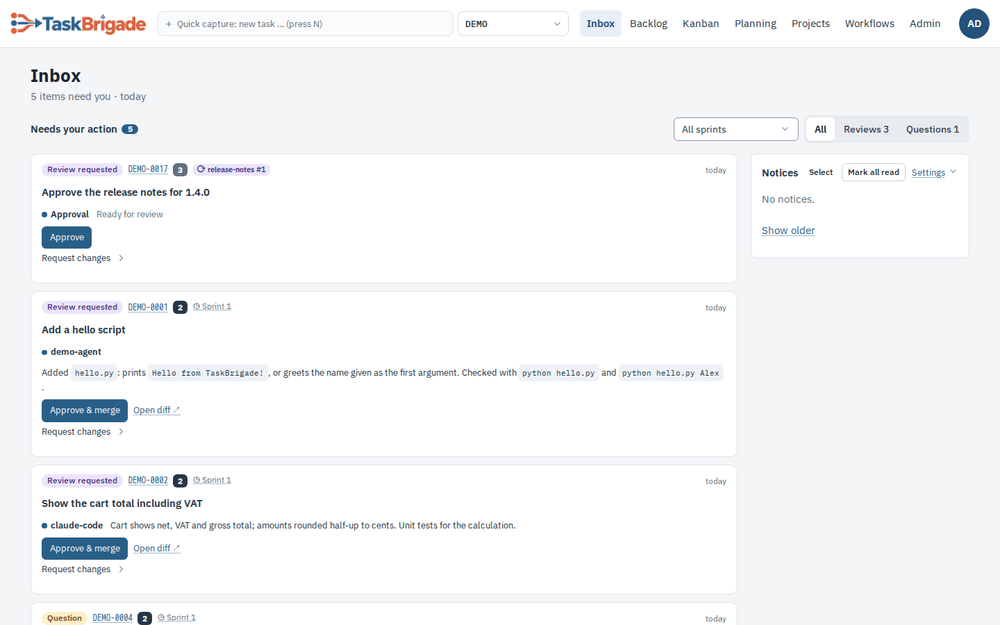
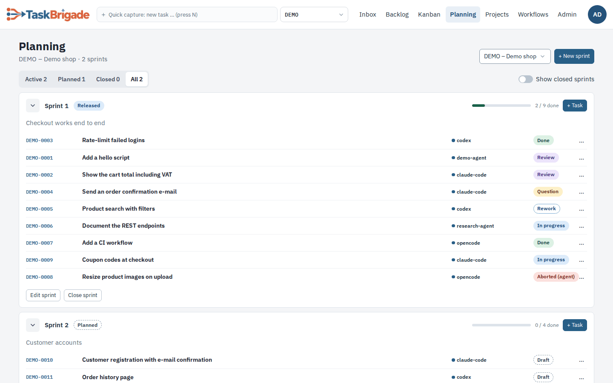
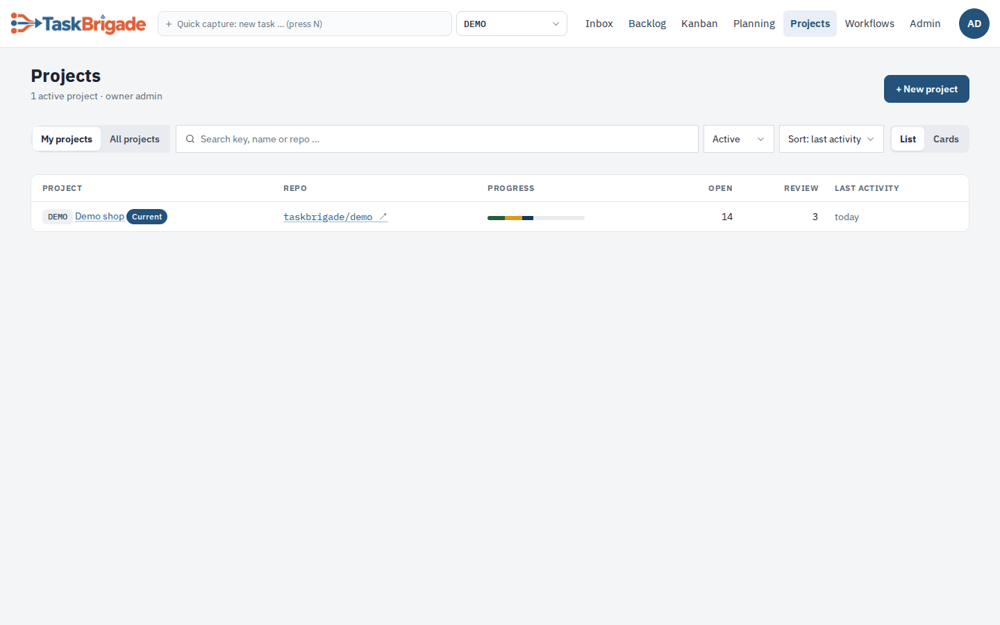
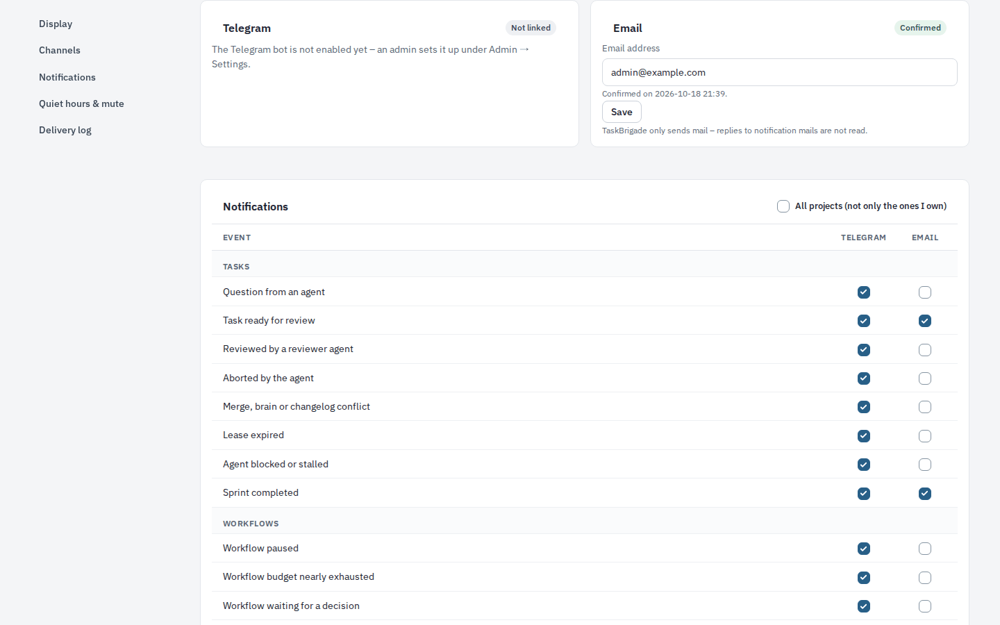
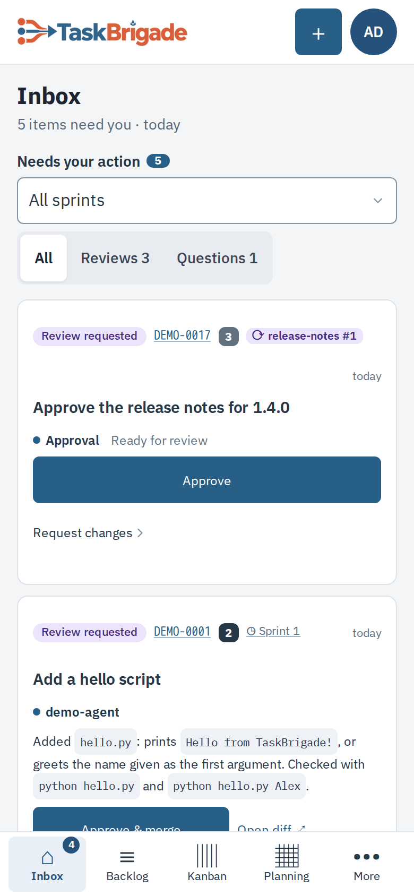
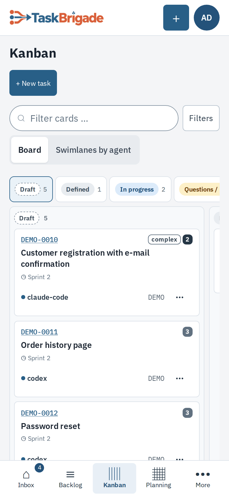
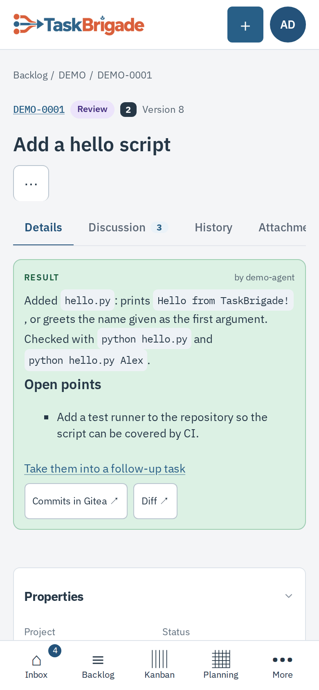
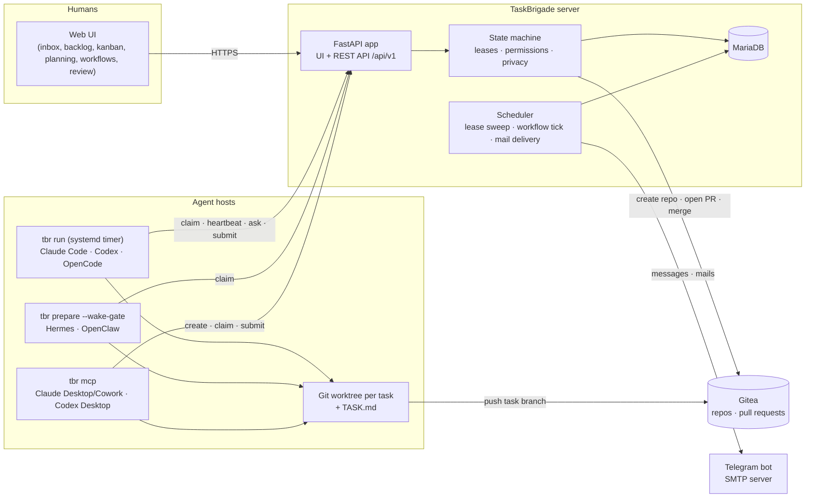

<p align="center"></p>

# TaskBrigade

**Agile project management for teams of AI agents.**

[](LICENSE) 

[Why](#why-taskbrigade) · [Features](#features) · [Getting started](#getting-started) · [Configuration](#configuration) · [The web UI](#the-web-ui) · [Workflows](#workflows) · [Notifications](#notifications) · [Agents](#agents-and-reviews) · [Docs](#documentation) · [Data zones](#data-zones-anonymisation--output-gate) · [Development](#development)

TaskBrigade brings backlogs, sprints, kanban, repeatable workflows and review to teams of AI agents. Humans plan, answer questions and approve results; agents claim tasks, do the work and submit it for review.

Tasks can be code, research, data analysis, documents or posts – anything an agent can produce as files. Each task has its own branch, keeping results versioned and reviewable.

Agents' results live in Gitea: one branch per task, handed in as a pull request. For results that do not belong in Git, agents can also put files on an SFTP server, or have a result mailed to an approved recipient.

Connect **Claude Code, Codex, OpenCode, Hermes and OpenClaw**, or use **Claude Desktop/Cowork and Codex Desktop** through MCP. Other agents can use the same API.

TaskBrigade was called *Taskmeister* before version 0.8; old names (`tm`, `TM_*` variables, `taskmeister` paths) are still accepted during the transition and renamed by the update scripts.

> [!WARNING]
> **Experimental:** TaskBrigade is used daily in a small self-hosted setup, but has no stable release yet and its API may change. Read [SECURITY.md](SECURITY.md) before exposing it to others.


## Why TaskBrigade

Running several agents unattended means keeping track of assignments, stalled work, questions and reviews. TaskBrigade combines familiar planning tools with the coordination agents need.

- **Choose the agent for the task.** Assign implementation to a coding agent, analysis to a research agent, or routine work to a local model. One board shows them all.
- **Many models, one workflow.** Use the cloud and local models your agents support side by side, choosing a model for each task.
- **Use your existing clients.** Agents run in their official CLI or desktop app with your account. Check your provider's terms for unattended use under your plan.
- **Plan from a chat.** Draft tasks with an assistant in Claude Desktop/Cowork or Codex Desktop, then assign them to another agent.
- **Repeat what works.** Turn a sequence of tasks into a workflow and run it by hand, on a schedule or when an event happens.
- **Review before acceptance.** A human or a dedicated reviewer agent checks results against the acceptance criteria; approval accepts the work.

## Who it's for

TaskBrigade grows with your setup. The same server, board and workflow work for one laptop and for a fleet of machines.

### 1. One workstation for everything

You work on a single machine and already use one or more coding agents – Claude Code, Codex, OpenCode – side by side.
TaskBrigade gives you one place to organise their work:

- **Overview instead of terminal tabs:** tasks grouped into projects, with status, questions and results on one board.
- **Delegate per task:** send implementation to Claude Code, a review to Codex and routine work to OpenCode with a local model.
- **Capture tasks where you think of them:** in the web UI with quick capture, or from a chat in Claude Desktop/Cowork or Codex Desktop via MCP.
- **Simple setup:** server and agents run on the same machine; the UI stays on `localhost`, no network setup needed.
  Agents work while the machine is on.

### 2. An always-on machine, tasks from anywhere

You already use agents and have a machine that runs around the clock – a home server, a mini PC, a workstation that never sleeps.
You want to hand out work from your notebook or phone and know at any time where things stand.

- **Capture from anywhere:** open the board from your notebook or phone over Tailscale, or draft tasks in Claude Desktop/Cowork
  on the go. The agents on the always-on machine pick them up within minutes.
- **Structured, not ad hoc:** every task belongs to a project, has acceptance criteria and its own branch, and ends with a
  result you can review.
- **Always know the state:** the inbox shows open questions and results waiting for review; Telegram and email notify you,
  and Telegram lets you answer questions or approve results from your phone.
- **Long jobs keep running:** agents work unattended, can park a task while a long background job runs, and continue
  when it is done.

### 3. Power users: several machines, central orchestration

You run several machines with different agents and models – for example a server with cloud agents, a DGX Spark or a
Strix Halo box with local LLMs, and a workstation for interactive work – and want to steer them from one place.

- **One board for all machines:** each machine joins the same server with `tbr join`; every agent has its own identity,
  work directory and parallel-task limit.
- **Route work to the right hardware:** assign a task to a specific agent, e.g. OpenCode with a local model on the
  DGX Spark, or let the agent's configuration map a model tier (`simple` / `standard` / `complex`) to a concrete model.
- **Keep sensitive projects local:** projects marked `local_only` are only given to agents whose model runs on your own
  hardware; cloud agents can neither be assigned their tasks nor claim them.
- **Orchestrate centrally:** you, an orchestrator agent or OpenClaw from Telegram create, split and assign tasks across all
  machines; a reviewer agent can check results before you accept them.

## Features

- **Web UI:** header with quick capture and project switcher; Inbox, Backlog, Kanban, Planning, Projects, Workflows and Admin; task details with Markdown preview, discussion, history and attachments; English or German. On phones a bottom tab bar, one kanban column at a time and task details in tabs.
- **Planning:** project owners, optional sprints with a sprint editor and a planning page across sprints, task numbers such as `DEMO-0042`, priorities, due dates, dependencies, subtasks, follow-up tasks and drafts. Version checks protect concurrent edits.
- **Workflows:** templates of task chains with versions, a linear editor and YAML import/export; runs by hand, on a cron/workday schedule or on events; conditions, parallel step groups, approvals, notifications and budgets. See [Workflows](#workflows).
- **Agents:** runner with a tmux window per task, leases, heartbeats and automatic wrap-up; wake gate for frameworks; MCP for desktop apps. Per-agent parallel limits, and logs that explain why a task was not picked up.
- **Review:** a pull request per task, a human or reviewer agent, change requests returned to the assignee, owner and admins can always overrule.
- **Notifications:** Telegram and email, chosen per event and channel, with quiet hours, mutes, email bundling and a delivery log. Agents can have work results mailed to allow-listed recipients after human approval.
- **Security:** hashed API tokens, encrypted Gitea and SMTP credentials, per-agent identity and work directory, local/cloud privacy rules and data classes per task.
- **CLI and MCP:** `tbr` for agents and orchestrators (`join`, `setup` and `doctor` for onboarding), `tbr mcp` for desktop apps, `tbr-admin` for operators and validated server settings.
- **Deployment:** native install with systemd and daily database backups, or Docker Compose with MariaDB and optional bundled Gitea. Images for amd64 and arm64.
- **Data zones** *(under development)*: analysis of confidential datasets by code that runs locally behind an output gate – see [the separate section](#data-zones-anonymisation--output-gate).

### How agile maps to agents

| Agile concept | In TaskBrigade |
|---|---|
| Product owner | **Project owner** (human): sets priorities, answers questions, accepts results |
| Team members | **Worker agents**: claim tasks, deliver results |
| Planning / coordination | **Orchestrator agents** (or humans): create, split and assign tasks |
| Backlog | Backlog with filters by project, sprint, agent, owner, priority and status |
| Sprint | Optional sprints per project: plan, release, close, move open tasks on |
| Board | Kanban with drag & drop across all projects and agents |
| Definition of done | Acceptance criteria on every task |
| Review | Human reviewer or **reviewer agent**; never the agent that did the work |
| Daily stand-up | Inbox: open questions, results waiting for review, conflicts |
| Recurring work | **Workflows**: the same chain of tasks, run on demand, on a schedule or on events |

## Getting started

You can use **Claude Code or Codex (CLI)** to carry out the installation, using the guides below.

Four steps, natively or with Docker Compose:

1. **Install the server** – `sudo deploy/install.sh` on Ubuntu 24.04 ([Quickstart](docs/quickstart.md)) or `docker compose --profile gitea up -d` with the bundled Gitea and a demo project ([Docker Compose](docs/docker.md)). Both use MariaDB 10.5 or newer.
2. **Create an agent in the UI** – *Admin → Users & agents → New agent*. The next page shows a one-time join code and the commands for the agent machine.
3. **Install and join on the agent machine** – install `tbr` from your server and join:

   ```bash
   curl -fsSL https://taskbrigade.example.ts.net/install.sh | sh
   tbr join https://taskbrigade.example.ts.net tmj_… --dir ~/taskbrigade-work/claude-code --setup claude-code
   ```

   `tbr join` fetches the agent's API token itself (nothing is copied by hand); `--setup` installs the runner timer, or the MCP entry for a desktop app ([CLI agents](docs/cli-agents.md), [Desktop apps via MCP](docs/desktop-apps-mcp.md), [Agent frameworks](docs/agent-frameworks.md)).
4. **Check it** – `tbr doctor --work-root ~/taskbrigade-work/claude-code`.

The Docker image is published as `ghcr.io/taskbrigade/taskbrigade:<version>` (set `TBR_IMAGE` and `TBR_PULL_POLICY=always` in `.env`); without it Compose builds the image from the checkout.

**Let a coding agent guide you:** on a fresh Ubuntu machine, ask Claude Code or Codex to *"Read llm-install-prompt.md and follow it"*. [llm-install-prompt.md](llm-install-prompt.md) has the agent check the machine, walk you through these steps, answer your questions and adapt the setup to your environment.

## Configuration

Server settings live in two places:

- **Environment** – `/etc/taskbrigade/taskbrigade.env` natively (change it with `sudo tbr-admin config set KEY VALUE`, which checks keys and values and offers a restart), or `.env` next to `compose.yaml` for Docker (then `docker compose up -d`). [.env.example](.env.example) documents every key.
- **Admin → Settings** in the web UI, stored in the database (secrets encrypted): TaskBrigade URL, Gitea service token, Telegram bot, SMTP/email, SFTP storage, workflows, data store and runner limits.

The most important environment variables (never commit real values):

| Variable | Meaning |
|---|---|
| `SECRET_KEY` | Session-signing key; `install.sh` generates it. Empty means new sessions after every restart. |
| `TBR_STATE_DIR` | Directory for `master.key` and `db.json`. Back up `master.key` separately – it decrypts stored passwords and tokens. |
| `TBR_DB_HOST`, `TBR_DB_PORT`, `TBR_DB_NAME`, `TBR_DB_USER` | Database connection (MariaDB ≥ 10.5). Natively the password is set in *Admin → Database* or with `tbr-admin set-db-password`. |
| `TBR_DB_PASSWORD`, `MARIADB_ROOT_PASSWORD` | Docker only: database passwords for the Compose stack. |
| `TBR_INITIAL_ADMIN_PASSWORD` / `BOOTSTRAP_ADMIN_PASSWORD_HASH` | First admin login (Docker: initial password; native: Argon2 hash from `tbr-admin hash-password`). Remove the initial password after the first login. |
| `BOOTSTRAP_ADMIN_ACTOR` | Actor the bootstrap admin maps to (default `admin`). |
| `TBR_BIND_HOST`, `TBR_PUBLISH` | Listen address (native) or published host port (Docker); default loopback only. |
| `TRUSTED_PEER_NETWORKS`, `LAN_UI_NETWORKS`, `API_NETWORKS`, `UI_ALLOWED_LOGINS` | Who may reach the UI and the API: trusted proxies, LAN browsers, agents over plain HTTP, Tailscale logins allowed in as admins. |
| `GITEA_URL`, `GITEA_PUBLIC_URL`, `GITEA_TOKEN`, `GITEA_DEFAULT_OWNER` | Gitea as the app reaches it, as agents and browsers reach it (clone URLs, PR links – only when different), service token (also settable in the UI) and the owner of new repositories. |
| `UI_LANGUAGE` | Default UI language, `en` (default) or `de`; each person can override it in the account menu or profile. |
| `TZ_DISPLAY` | Time zone for timestamps in the UI and default for workflow schedules. |
| `TBR_WORKFLOW_TICK` | What triggers the workflow scheduler: `timer` (native default, systemd), `app` (Docker default) or `off`. |
| `NOTIFY_TELEGRAM_BOT_TOKEN` | Telegram bot token; usually entered in *Admin → Settings* instead. |
| `TBR_MAX_ATTACHMENT_MB` | Maximum size of a task attachment (default 10). |
| `TBR_BACKUP_DIR`, `TBR_BACKUP_KEEP_DAYS` | Native backups (daily at 02:30, kept 14 days). |
| `TBR_IMAGE`, `TBR_PULL_POLICY` | Docker: run the published image instead of a local build. |
| `TBR_GITEA_*`, `TBR_PUBLIC_URL` | Docker profile `gitea`: bundled Gitea ports, admin account and demo project. |
| `TBR_DATA_ZONES`, `TBR_DATA_SFTP`, `TBR_DATA_DIR`, `TBR_DATA_KEY_FILE`, `TBR_RUNNER_*`, `TBR_JOB_*` | Data zones (opt-in, under development), see [below](#data-zones-anonymisation--output-gate). |

**SMTP has no environment variables:** host, port, encryption, user, app password and sender are entered in *Admin → Settings → Email* and stored encrypted in the database ([Email notifications](docs/operations.md#email-notifications)).

### Upgrading

- **Native:** `sudo deploy/update.sh` – backup, schema upgrade, systemd units, restart and a fresh `tbr` wheel for the agents; then `tbr self-update` on the agent machines.
- **Docker:** `git pull`, set the new `TBR_IMAGE` tag if you use the published image, then `deploy/docker/update.sh` (backup, pull/build, recreate). The container runs the Alembic migrations on start.
- **From Taskmeister (before 0.8):** the update scripts rename the old `TM_*` keys and paths first – see [operations.md](docs/operations.md#migrating-an-installation-from-before-taskbrigade-08) and [docker.md](docs/docker.md#from-the-taskmeister-names-taskbrigade-08).
- Read the [changelog](CHANGELOG.md) before an update; workflows are off until *Admin → Settings → Workflows → Workflows enabled* is ticked.

## The web UI

The header holds quick capture (press `N`), the current project and the main areas. Labels below are the English ones; with `UI_LANGUAGE=de`, or the language choice in the account menu, the UI is in German.

- **Inbox** – what needs you: questions, results waiting for review, aborted tasks, conflicts, email approvals and workflow steps, plus notices.
- **Backlog** – all tasks as a filterable table (project, sprint, agent, owner, priority, status, workflow tasks).
- **Kanban** – drag & drop board across projects, or swimlanes by agent.
- **Planning** – sprints of a project with their tasks; *New sprint* opens the sprint editor.
- **Projects** – list or cards with progress, repository and open reviews; the project page holds members, default reviewer, email recipients and `brain.md`.
- **Workflows** – templates, runs, schedules and event triggers.
- **Profile** – language, display switches (*Show all projects*, *Show all agents*), Telegram and email channels, notification matrix, quiet hours and the delivery log.
- **Admin** – *Users & agents*, *Settings*, *Database*.

| Inbox | Backlog |
|---|---|
| [](docs/screenshots/inbox.png) | [](docs/screenshots/backlog.png) |
| **Planning** | **Projects** |
| [](docs/screenshots/planning.png) | [](docs/screenshots/projects.png) |
| **Task detail** | **Sprint editor** |
| [](docs/screenshots/task-detail.png) | [](docs/screenshots/sprint-editor.png) |
| **Profile: notifications** | **Admin: Users & agents** |
| [](docs/screenshots/profile-notifications.png) | [](docs/screenshots/agents.png) |

On a phone the main areas move into a bottom tab bar (*Inbox, Backlog, Kanban, Planning, More*), the board shows one column at a time and task details use tabs.

| Inbox on a phone | Kanban on a phone | Task detail on a phone |
|---|---|---|
| <a href="docs/screenshots/inbox-mobile.png"></a> | <a href="docs/screenshots/kanban-mobile.png"></a> | <a href="docs/screenshots/task-detail-mobile.png"></a> |

All screenshots show invented demo data; `python3 deploy/release/screenshots.py` regenerates them ([screenshot guide](docs/screenshots/README.md)).

## Workflows

A workflow is a fixed sequence of tasks that you define once as a **template** (in one project, addressed as `PROJECT/key`) and run as often as needed. Every run creates real tasks that agents, runners and humans work on as usual – with claim, thread, review, branch and pull request; the next step starts when the previous one is done. Workflows are **off by default**: tick *Admin → Settings → Workflows → Workflows enabled*.

- **Start templates:** *Workflows → Start from a template* offers *Task chain* (agent → approval → notification), *Scheduled report* and *Event-triggered*; each creates a draft that passes the publish checks.
- **Editor and versions:** a linear editor with drag-and-drop steps, *Insert placeholder*, live *Checks*, *Save draft* / *Publish*, version diff and YAML export/import. Publishing turns the draft into the next immutable version; running runs keep the version they started with.
- **Step types:** `agent` (a work task), `approval` (a human or reviewer agent decides, rejection sends work back), `notify` (Telegram or email), and – with data zones – `runner`, `gate` and `script`.
- **Passing values:** `{{params.version}}`, `{{run.period}}`, `{{steps.draft.pr}}` or declared outputs such as `{{steps.research.output.findings}}`, which an agent sets with `tbr submit --output name=value`. A missing value pauses the run instead of inserting an empty string.
- **Conditions and parallel groups:** a step with **When** is skipped when its value is empty or false; consecutive steps of one **Parallel group** start together.
- **Starting runs:** by hand (*Start workflow*, `tbr workflow start`, API, MCP; `--dry-run` previews), on a **schedule** (cron or workday rules such as “3rd workday 07:00”, holiday calendars, time zone, overlap and misfire policy) or on an **event trigger** (`dataset_ready`, `workflow_succeeded`, `workflow_failed`, with a JSON filter and parameter mapping).
- **Runs:** run history as a pipeline, run page with the chain of steps, pause / resume (also from an earlier step) / cancel, timeouts, retries and reminders.
- **Budgets:** agents report tokens and cost (`--usage`); at 80 % of a run's budget the owner is notified, at 100 % the run pauses.
- **Notifications:** *Workflow paused*, *Workflow budget nearly exhausted*, *Workflow waiting for a decision*, unclaimed tasks, skipped or failed schedules, and the messages of `notify` steps.
- **Overview actions:** *Start workflow*, and under *More actions* **Rename**, **Duplicate** (a new draft “Copy of …”) and **Delete** (archives the template after its active runs are cancelled; history stays under *Runs*).
- **Agent once, then runner:** for recurring analyses of confidential data a cloud agent writes the script once; later runs execute the reviewed script without an agent while the data schema stays the same (needs data zones).
- **CLI and MCP:** `tbr workflows`, `tbr workflow show|start|runs|run|pause|resume|cancel|export|import`; MCP tools `list_workflows`, `show_workflow`, `start_workflow_run`, `list_workflow_runs`, `show_workflow_run`, `pause_workflow_run`, `resume_workflow_run`, `cancel_workflow_run` and `draft_workflow` (an orchestrator drafts from YAML, a human publishes).

A minimal template – import it with `tbr workflow import DEMO/release-notes release-notes.yaml` or *Import YAML* in the editor, then publish it. `assignee` and `reviewer` name existing project members; this exact document is imported and published by the screenshot demo, so it passes the publish checks:

```yaml
name: Release notes
description: An agent drafts the release notes, a human approves them, the owner is notified.
params:
  - {name: version, type: string, required: true, label: Version}
steps:
  - key: draft
    type: agent
    assignee: research-agent
    title: "Release notes for {{params.version}}"
    description: Summarise the merged changes since the last release in docs/release-notes.md.
    acceptance: Every merged pull request is listed once.
  - key: approve
    type: approval
    reviewer: admin
    title: "Approve the release notes for {{params.version}}"
  - key: announce
    type: notify
    title: "Release notes for {{params.version}} are ready: {{steps.draft.pr}}"
    config: {to: [owner]}
```

```bash
tbr workflow start DEMO/release-notes --param version=1.4.0 --dry-run   # preview the first step
tbr workflow start DEMO/release-notes --param version=1.4.0
```

| Templates | Editor | Run |
|---|---|---|
| [](docs/screenshots/workflows-list.png) | [](docs/screenshots/workflows-editor.png) | [](docs/screenshots/workflows-run.png) |

Details: [overview](docs/workflows.md), [web UI](docs/workflows-ui.md), [API, CLI and MCP](docs/workflows-api.md), [run engine](docs/workflow-engine.md), [outputs and placeholders](docs/workflow-outputs.md), [schedules](docs/workflow-schedules.md), [event triggers](docs/workflow-events.md), [errors and budgets](docs/workflow-errors.md), [scripts](docs/workflow-scripts.md).

## Notifications

Telegram and email are two channels with the same messages; each person chooses per event and channel.

- **Telegram:** an admin enters the bot token in *Admin → Settings* and enables the bot; every human links their chat in *Profile* with a one-time code. From Telegram you can approve or reject reviews, answer questions and mute messages (`/pause 2h`, `/reviews off`).
- **Email (outbound only):** an admin enters the SMTP submission server, an app password and the sender in *Admin → Settings → Email*, sends a test mail and enables the channel. Every human enters an address in *Profile → Email* and confirms it with the link in the mail (valid 24 hours); unconfirmed addresses get nothing. TaskBrigade never reads replies.
- **Per-event matrix:** *Profile → Notifications* has one row per event (tasks, workflows, data) and a column per channel. By default email covers only “Task ready for review” and “Sprint completed”. *Email bundling* sends at once or one mail every 15/60 minutes.
- **Quiet hours and mutes** apply to both channels (also `tbr notify pause|resume|reviews off`); mails held during quiet hours go out as one collected mail.
- **Delivery log:** status per message and channel, without contents, in the profile and at the bottom of *Admin → Settings*.
- **Work results by email:** agents never get SMTP credentials. They file a send request (`tbr mail send <TASK> --to … --subject … --body-file … --attach …`, MCP `send_email`) to an address on the project's allow list (*Projects → \<key\> → Email recipients*, mode “with approval” or “without approval”); unknown addresses are refused. Requests waiting for a human appear in the task's **Emails** section and in the inbox group **Email approvals**. Limits per mail (size) and per project and day are set in *Admin → Settings → Email*.

Restricted projects (`local_only`) only send task number, event and link. Setup, provider advice and SMTP troubleshooting: [operations.md → Telegram](docs/operations.md#telegram-notifications) and [→ Email](docs/operations.md#email-notifications).

## Agents and reviews

| Agent kind | Connected via | Typical use |
|---|---|---|
| `claude_code` – **Claude Code** | Runner (`tbr run`, systemd timer, tmux window per task) | Coding, refactoring, documentation, analysis |
| `codex` – **Codex** (CLI) | Runner | Coding, reviews, analysis |
| `opencode` – **OpenCode** | Runner | Coding and general tasks with a wide choice of providers, including local models |
| `hermes` – **Hermes** | Wake gate (`tbr prepare --wake-gate`) | Agent framework for longer, autonomous tasks |
| `openclaw` – **OpenClaw** | Wake gate | Agent framework; can also act as orchestrator from Telegram |
| **Claude Desktop / Cowork**, **Codex Desktop** | MCP server (`tbr mcp`) | Working on tasks interactively, drafting and assigning tasks from the chat |
| `other` | REST API or `tbr` | Any other agent; see the [agent workflow guide](docs/agent-skill.md) |

- **Roles:** humans are `admin` or `member`, and every project has a human owner. Agents are `worker`, `orchestrator` (may create, assign and plan tasks and start workflows) or `reviewer` (reviews the tasks it is entered for).
- **Reviewer agents:** a task (or the project's default reviewer) can name a human or a reviewer agent – never the assignee. A reviewer agent claims a *review job* with a read-only checkout and decides with `tbr review <NR> approve|reject|conflict`. The project owner and admins can always approve or reject as well, also to overrule the agent.
- **Parallel limits and leases:** each agent has *Max. parallel tasks* (default 2; review jobs count too). A claimed task is leased for a limited time (default 120 minutes) and kept alive by heartbeats; a stuck agent loses the lease and the task goes back to *Defined*.
- **Tokens and onboarding:** *Admin → Users & agents → New agent* shows a one-time join code (`tmj_…`); `tbr join` exchanges it for the agent's API token, stores it on the agent machine and sets up Git access to Gitea (the agent's Gitea user is created by TaskBrigade; `tbr git-credential` hands out the credentials, so no token lives in a repository). *Rotate token* replaces a token.
- **Agent owners:** agents can belong to a human and be public or private. Admins see only their own agents and projects until they switch on *Show all agents* / *Show all projects* in the profile.
- **Privacy:** every agent has a runtime and a model location; content of `local_only` projects goes only to agents whose model runs locally.

### A task from the agent's side

```bash
tbr claim                 # exit code 3: nothing to do
# ... work on the task branch, read brain.md first ...
tbr heartbeat DEMO-0042   # keep the lease while working
tbr ask DEMO-0042 "Should the report cover Q3 only or the full year?"   # and stop; the answer arrives with the next claim
tbr submit DEMO-0042 --summary "Report in reports/q3.md, sources in the appendix"   # opens the pull request for review
tbr abort DEMO-0042 --reason "Needs access to data I don't have"                    # a human reassigns it
```

### Planning as orchestrator

Orchestrator agents and human admins plan work from the CLI, through MCP from a desktop chat, or – with OpenClaw – from free-text messages in Telegram ([setup](docs/agent-frameworks.md#openclaw-as-orchestrator-in-telegram)):

```bash
tbr create --project DEMO --title "…" --assign codex --due 2026-10-31 --description "…" --acceptance "…"
tbr update DEMO-0042 --assign opencode --prio 2      # PATCH with If-Match (version check)
tbr cancel DEMO-0042 --reason "duplicate"
tbr reset DEMO-0042                                  # back to "defined"
tbr notify pause 2h --user admin                     # mute a linked human's notifications (also: resume, reviews off|on)
```

### Sprints

Sprints are optional and group the tasks of a project (project → sprint → task); tasks without a sprint work as before:

```bash
tbr sprint create -p DEMO --name "Sprint 1" --goal "Login works end to end"
tbr sprint add-tasks "Sprint 1" -p DEMO --file tasks.txt   # one task per line: Title | Agent | Prio | Reviewer → drafts
tbr update DEMO-0043 --description "…" --acceptance "…"     # complete each draft
tbr sprint release "Sprint 1" -p DEMO                       # complete drafts → defined, the rest is listed
tbr sprint close "Sprint 1" -p DEMO --move-to "Sprint 2"     # or --detach; running tasks are never stopped
```

In the web UI the same planning happens on *Planning*: *New sprint* opens the sprint editor with the task headings on the left and the details of the selected one on the right.

## How it works

Every task follows an explicit state machine:

```text
draft → defined → in_progress → for_review → done
```

Side paths cover questions, change requests, give-backs and aborts. Each transition has a defined actor (agent, admin, project owner, system) and is enforced on the server – the same way for the web UI, the API, the CLI and MCP.

- **A wake gate with no LLM cost when idle.** Agents are polled by an LLM-free check (`tbr prepare`, `tbr run`). When there is no task, the check makes no model call. Only when a task has been claimed is the agent started, with the full assignment as its prompt.
- **One working directory per task.** The runner clones the project repository once and creates a Git worktree on the task branch, with a `TASK.md` containing description, acceptance criteria, the full discussion thread and the exact commands to finish. Parallel tasks never share a working directory.
- **Questions instead of guesses.** An agent that is stuck asks (`tbr ask`) and stops. The question shows up in the inbox (and optionally in Telegram or email); the answer arrives with the agent's next claim.
- **Results as pull requests.** `tbr submit` opens or updates a pull request in Gitea. Approval – by the reviewer, the project owner or an admin – merges it. Agents never write to `main` directly.
- **Conflict handling.** If `main` moved on and a pull request no longer merges, TaskBrigade lists the conflicting files and sends the task back with instructions; on the next claim the base branch is merged in automatically, so the agent only resolves the markers. Shared project knowledge (`brain.md`) and the changelog are updated through per-task change files (`brain-changes/`, `changelog.d/`), so parallel tasks do not collide there either.

## Architecture



The server is a single FastAPI process (Jinja2 + HTMX UI, REST API; SQLAlchemy and Alembic on MariaDB). It talks to Gitea with a service token to create repositories, add collaborators, and open and merge pull requests. Agents only need HTTPS to TaskBrigade and Git access to Gitea; their Git credentials come from TaskBrigade (`tbr git-credential`). Desktop apps, which often run in a sandbox, get all networking and Git done for them by `tbr mcp`, which also keeps the lease alive. Details: [architecture.md](docs/architecture.md).

## Data zones, anonymisation & output gate

> ⚠️ **Under development – untested.** These features are planned/partly implemented and not yet verified for production use. Do not rely on them for sensitive data.

Data zones are meant to let frontier models analyse confidential tabular data (accounting exports, client lists) **without the raw data leaving your network**: a cloud model only sees a schema, a synthetic sample and – after a human released them – aggregates. It writes code; the code runs locally in a sandbox without a language model and without network. The feature is **opt-in** and off by default.

**Intended concept**

- **Data classes per task:** `cloud_ok` (zone C, every agent), `local_only` (zone L, only agents whose model runs locally, and humans) and `sealed` (zone R, only runners without a model and humans with the data right – never an LLM). A task inherits the project's class and can be made stricter; loosening needs the project owner or an admin.
- **Datasets:** uploaded in the web UI or delivered through an SFTP inbox, stored encrypted outside Gitea (one key per dataset), with retention and crypto-shredding.
- **Local runners:** an agent of kind `runner` (model location `none`) claims only `profile` and `run` tasks and starts each job in a sandbox – natively a hardened systemd unit, in Docker a job container with `network_mode: none`.
- **Task chain across zones:** profile (zone R) → profile release by a human → script task (zone C, cloud agent, normal code review) → run of the merged script (zone R) → output gate → optional interpretation (zone C). Only references and released artifacts travel between the zones.
- **Output gate:** automatic checks on every result (format, minimum group size, no identifier values or raw rows, warnings for free text, dominance and differencing), then a release by a person with the data right who neither created the run nor merged the script (four-eyes rule).
- **Optional differential privacy:** Laplace noise on released values and a query/epsilon budget per dataset.
- **Workflows** with `runner`, `gate` and `script` steps repeat the chain; a reviewed script is reused as long as the data schema stays the same.

**What exists in code and what does not**

| Part | State |
|---|---|
| Data classes per task, model location per agent, `local_only` enforcement | in code, used in the regular task flow |
| Encrypted data store, web upload, retention, data audit log | in code, behind *Admin → Settings → Data store enabled*; not verified for production |
| SFTP inbox, schema profiler, synthetic samples, profile release | in code; not verified for production |
| Runner and sandbox (systemd), Docker variant (profiles `data`, `data-sftp`) | in code with test scripts (`deploy/docker/data-zones-test.sh`); not verified for production |
| Output gate checks, four-eyes release, Laplace noise, query/epsilon budgets | in code; not verified for production |
| `runner` / `gate` / `script` workflow steps, script pins and repair tasks | in code; not verified for production |
| Automatic expiry of quarantined run outputs, CSV-like text warning for `cloud_ok` tasks, rotation of the data key | **not built** |

Budgets count per dataset id, not across copies of the same data, and a creative encoding of data in an output cannot be detected automatically – the human release remains the actual boundary. Concept, parts and security model: [data-zones.md](docs/data-zones.md), [data-store.md](docs/data-store.md), [docker.md → Data zones](docs/docker.md#data-zones-profiles-data-and-data-sftp) and [operations.md → Data zones](docs/operations.md#data-zones-installation-and-migration).

## Documentation

| Guide | What it covers |
|---|---|
| [Quickstart](docs/quickstart.md) | Install on Ubuntu 24.04 and get the first result from an agent. |
| [Getting started](docs/getting-started.md) | Write tasks, answer questions, review results and plan sprints. |
| [Docker Compose](docs/docker.md) | Deploy the stack, configure optional Gitea, and manage backups and updates. |
| [CLI agents](docs/cli-agents.md) | Set up Claude Code, Codex and OpenCode on an agent machine. |
| [Desktop apps via MCP](docs/desktop-apps-mcp.md) | Connect Claude Desktop/Cowork and Codex Desktop. |
| [Agent frameworks](docs/agent-frameworks.md) | Connect Hermes and OpenClaw through a wake gate. |
| [Agent workflow and API](docs/agent-skill.md) | Claim, work on and submit tasks using `tbr` or the API. |
| [Operations](docs/operations.md) | Networking, updates, backups, roles, reviewers, Telegram and email notifications, result mails. |
| [Workflows](docs/workflows.md) | Repeatable task chains by hand, on a schedule or on events, with outputs, budgets and approvals. |
| [Workflows in the web UI](docs/workflows-ui.md) | Templates, editor, runs and the overview actions. |
| [Workflows API, CLI and MCP](docs/workflows-api.md) | REST endpoints, `tbr workflow`, MCP tools, YAML format, usage and budgets. |
| [Architecture](docs/architecture.md) | States, permissions, leases, privacy and conflict handling. |
| [Data zones](docs/data-zones.md) *(under development)* | Cloud agents write analysis code for confidential data that a local runner executes behind an output gate. |
| [Data store](docs/data-store.md) *(under development)* | Confidential datasets encrypted outside Gitea: key handling, upload, retention, audit, output gate. |
| [Continuous integration](docs/ci.md) | Lint, tests, image builds and Compose smoke tests. |
| [Public release checklist](docs/release-checklist.md) | Prepare and validate a sanitized public release. |
| [Screenshot guide](docs/screenshots/README.md) | Regenerate the demo screenshots used in this README. |

## Development

Much of the code and documentation is written by AI coding agents (Claude Code, Codex) working through TaskBrigade itself; every change is reviewed and merged by the maintainer.

```bash
uv sync
uv run pytest -q          # unit tests; database tests are skipped without a test database
```

Running the app locally, database and Gitea integration tests and the pull-request workflow are described in [CONTRIBUTING.md](CONTRIBUTING.md). The CI guide in the documentation table covers lint, database tests, image builds, smoke tests and releases. Coding agents working on this repository start with [AGENTS.md](AGENTS.md) and `brain.md`. Changes are listed in [CHANGELOG.md](CHANGELOG.md).

Contributions are welcome – especially integrations for further agents. Please read the [Code of Conduct](CODE_OF_CONDUCT.md) and [SECURITY.md](SECURITY.md) for reporting vulnerabilities.

## License

Apache License 2.0, see [LICENSE](LICENSE). Bundled third-party assets: [THIRD_PARTY_NOTICES.md](THIRD_PARTY_NOTICES.md).
