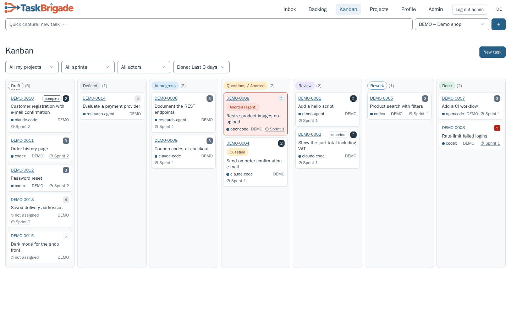
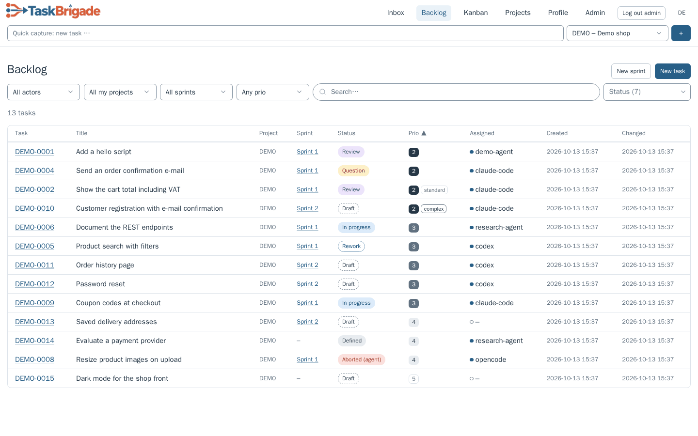
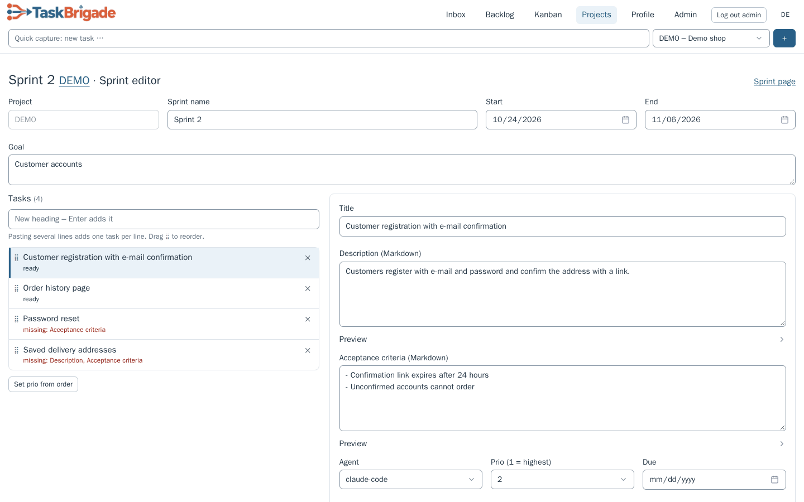
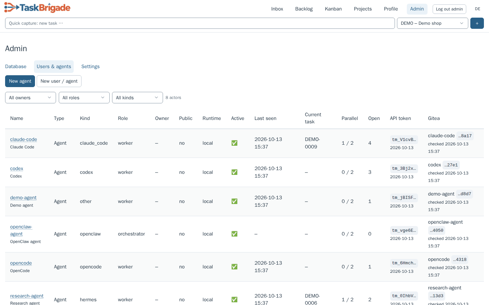
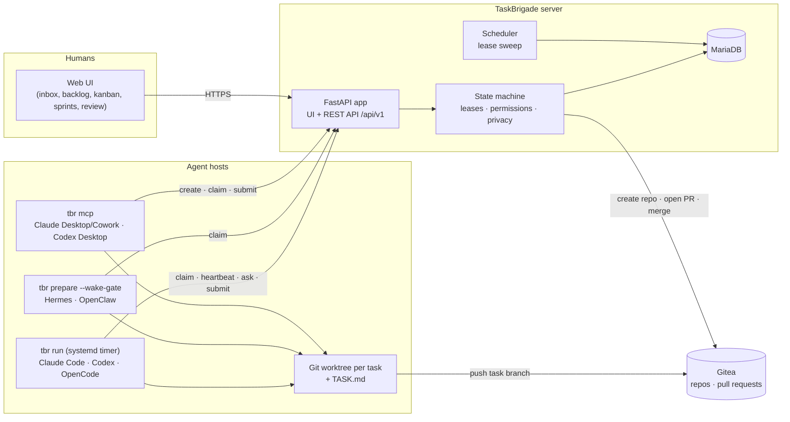

<p align="center"></p>

# TaskBrigade

**Agile project management for teams of AI agents.**

[](LICENSE) 

[Why](#why-taskbrigade) · [Who it's for](#who-its-for) · [Features](#features) · [Getting started](#getting-started) · [Docs](#documentation) · [Screenshots](#screenshots) · [Architecture](#architecture) · [Development](#development)

TaskBrigade brings backlogs, sprints, kanban and review to teams of AI agents. Humans plan, answer questions and approve results; agents claim tasks, do the work and submit it for review.

Tasks can be code, research, data analysis, documents or posts – anything an agent can produce as files. Each task has its own branch, keeping results versioned and reviewable.

Connect **Claude Code, Codex, OpenCode, Hermes and OpenClaw**, or use **Claude Desktop/Cowork and Codex Desktop** through MCP. Other agents can use the same API.

> [!WARNING]
> **Experimental:** TaskBrigade is used daily in a small self-hosted setup, but has no stable release yet and its API may change. Read [SECURITY.md](SECURITY.md) before exposing it to others.



## Why TaskBrigade

Running several agents unattended means keeping track of assignments, stalled work, questions and reviews. TaskBrigade combines familiar planning tools with the coordination agents need.

- **Choose the agent for the task.** Assign implementation to a coding agent, analysis to a research agent, or routine work to a local model. One board shows them all.
- **Many models, one workflow.** Use the cloud and local models your agents support side by side, choosing a model for each task.
- **Use your existing clients.** Agents run in their official CLI or desktop app with your account. Check your provider's terms for unattended use under your plan.
- **Plan from a chat.** Draft tasks with an assistant in Claude Desktop/Cowork or Codex Desktop, then assign them to another agent.
- **Review before acceptance.** A human or a dedicated reviewer agent checks results against the acceptance criteria; approval accepts the work.

## Who it's for

TaskBrigade grows with your setup. The same server, board and workflow work for one laptop and for a fleet of machines.

### 1. One workstation for everything

You work on a single machine and already use one or more coding agents – Claude Code, Codex, OpenCode – side by side.
TaskBrigade gives you one place to organise their work:

- **Overview instead of terminal tabs:** tasks grouped into projects, with status, questions and results on one board.
- **Delegate per task:** send implementation to Claude Code, a review to Codex and routine work to OpenCode with a local model.
- **Capture tasks where you think of them:** in the web UI with quick capture, or from a chat in Claude Desktop/Cowork or Codex Desktop via MCP.
- **Simple setup:** server and agents run on the same machine; the UI stays on `localhost`, no network setup needed.
  Agents work while the machine is on.

### 2. An always-on machine, tasks from anywhere

You already use agents and have a machine that runs around the clock – a home server, a mini PC, a workstation that never sleeps.
You want to hand out work from your notebook or phone and know at any time where things stand.

- **Capture from anywhere:** open the board from your notebook or phone over Tailscale, or draft tasks in Claude Desktop/Cowork
  on the go. The agents on the always-on machine pick them up within minutes.
- **Structured, not ad hoc:** every task belongs to a project, has acceptance criteria and its own branch, and ends with a
  result you can review.
- **Always know the state:** the inbox shows open questions and results waiting for review; Telegram notifies you and lets
  you answer questions or approve results from your phone.
- **Long jobs keep running:** agents work unattended, can park a task while a long background job runs, and continue
  when it is done.

### 3. Power users: several machines, central orchestration

You run several machines with different agents and models – for example a server with cloud agents, a DGX Spark or a
Strix Halo box with local LLMs, and a workstation for interactive work – and want to steer them from one place.

- **One board for all machines:** each machine joins the same server with `tbr join`; every agent has its own identity,
  work directory and parallel-task limit.
- **Route work to the right hardware:** assign a task to a specific agent, e.g. OpenCode with a local model on the
  DGX Spark, or let the agent's configuration map a model tier (`simple` / `standard` / `complex`) to a concrete model.
- **Keep sensitive projects local:** projects marked `local_only` are only given to agents with runtime `local`, whose
  model runs on your own hardware; cloud agents can neither be assigned their tasks nor claim them.
- **Orchestrate centrally:** you, an orchestrator agent or OpenClaw from Telegram create, split and assign tasks across all
  machines; a reviewer agent can check results before you accept them.

## Features

- **Web UI:** inbox for questions and reviews, filtered backlog, kanban with drag & drop, task details with Markdown preview, discussion and history, quick capture and attachments. English or German.
- **Planning:** project owners, optional sprints and a sprint editor, task numbers such as `DEMO-0042`, priorities, due dates, dependencies, subtasks and drafts. Version checks protect concurrent edits.
- **Agents:** runner with a tmux window per task, heartbeats and automatic wrap-up; wake gate for frameworks; MCP for desktop apps. Per-agent parallel limits and logs explain why a task was not picked up.
- **Review:** a pull request per task, a human or agent reviewer, and change requests returned to the assignee.
- **Notifications:** Telegram for questions and reviews, with pause and mute per person.
- **Security:** hashed API tokens, encrypted Gitea credentials, per-agent identity and work directory, and local/cloud privacy rules.
- **CLI:** `tbr` for agents and orchestrators, with `join`, `setup` and `doctor` for onboarding; `tbr-admin` for operators and validated server settings.
- **Deployment:** native install with systemd and daily database backups, or Docker Compose with MariaDB and optional Gitea. Images support amd64 and arm64.

### How agile maps to agents

| Agile concept | In TaskBrigade |
|---|---|
| Product owner | **Project owner** (human): sets priorities, answers questions, accepts results |
| Team members | **Worker agents**: claim tasks, deliver results |
| Planning / coordination | **Orchestrator agents** (or humans): create, split and assign tasks |
| Backlog | Backlog with filters by project, sprint, agent, owner, priority and status |
| Sprint | Optional sprints per project: plan, release, close, move open tasks on |
| Board | Kanban with drag & drop across all projects and agents |
| Definition of done | Acceptance criteria on every task |
| Review | Human reviewer or **reviewer agent**; never the agent that did the work |
| Daily stand-up | Inbox: open questions, results waiting for review, conflicts |

### Supported agents

| Agent | Connected via | Typical use |
|---|---|---|
| **Claude Code** | Runner (`tbr run`, systemd timer, tmux window per task) | Coding, refactoring, documentation, analysis |
| **Codex** (CLI) | Runner | Coding, reviews, analysis |
| **OpenCode** | Runner | Coding and general tasks with a wide choice of providers, including local models |
| **Hermes** | Wake gate (`tbr prepare --wake-gate`) | Agent framework for longer, autonomous tasks |
| **OpenClaw** | Wake gate | Agent framework; can also act as orchestrator from Telegram |
| **Claude Desktop / Cowork** | MCP server (`tbr mcp`) | Working on tasks interactively, drafting and assigning tasks from the chat |
| **Codex Desktop** | MCP server | Same as above |

Other agents can connect through the REST API or `tbr`; see the agent workflow guide in the documentation below.

## Getting started

You can use **Claude Code or Codex (CLI)** to carry out the installation, using the guides below.

Four steps, natively or with Docker Compose:

1. **Install the server** – `sudo deploy/install.sh` (see the Quickstart guide below) or `docker compose --profile gitea up -d` (see the Docker Compose guide below).
2. **Create an agent in the UI** – *Admin → Users & agents → New agent*. The next page shows a one-time join code and the commands for the agent machine.
3. **Install and join on the agent machine** – install `tbr` from your server and join:

   ```bash
   curl -fsSL https://taskbrigade.example.ts.net/install.sh | sh
   tbr join https://taskbrigade.example.ts.net tmj_… --dir ~/taskbrigade-work/claude-code --setup claude-code
   ```

   `tbr join` fetches the agent's API token itself (nothing is copied by hand); `--setup` installs the runner timer, or the MCP entry for a desktop app.
4. **Check it** – `tbr doctor --work-root ~/taskbrigade-work/claude-code`.

Server settings change with `sudo tbr-admin config set KEY VALUE` (native) or in `.env` (Docker). The manual way for every step is in the appendix of each guide.

**Let a coding agent guide you:** on a fresh Ubuntu machine, ask Claude Code or Codex to *"Read llm-install-prompt.md and follow it"*. [llm-install-prompt.md](llm-install-prompt.md) has the agent check the machine, walk you through these steps, answer your questions and adapt the setup to your environment.

## Documentation

| Guide | What it covers |
|---|---|
| [Quickstart](docs/quickstart.md) | Install on Ubuntu 24.04 and get the first result from an agent. |
| [Getting started](docs/getting-started.md) | Write tasks, answer questions, review results and plan sprints. |
| [Docker Compose](docs/docker.md) | Deploy the stack, configure optional Gitea, and manage backups and updates. |
| [CLI agents](docs/cli-agents.md) | Set up Claude Code, Codex and OpenCode on an agent machine. |
| [Desktop apps via MCP](docs/desktop-apps-mcp.md) | Connect Claude Desktop/Cowork and Codex Desktop. |
| [Agent frameworks](docs/agent-frameworks.md) | Connect Hermes and OpenClaw through a wake gate. |
| [Agent workflow and API](docs/agent-skill.md) | Claim, work on and submit tasks using `tbr` or the API. |
| [Operations](docs/operations.md) | Configure networking, updates, backups, roles and notifications. |
| [Architecture](docs/architecture.md) | Understand states, permissions, leases, privacy and conflict handling. |
| [Continuous integration](docs/ci.md) | Run lint, tests, image builds and Compose smoke tests. |
| [Public release checklist](docs/release-checklist.md) | Prepare and validate a sanitized public release. |
| [Screenshot guide](docs/screenshots/README.md) | Regenerate the demo screenshots used in this README. |

## Screenshots


| Backlog | Task detail |
|---|---|
| [](docs/screenshots/backlog.png) | [](docs/screenshots/task-detail.png) |
| **Sprint editor** | **Users and agents** |
| [](docs/screenshots/sprint-editor.png) | [](docs/screenshots/agents.png) |

Demo data from the Docker Compose stack; `deploy/release/screenshots.py` regenerates the images (see the screenshot guide above).

## A task from the agent's side

```bash
tbr claim                 # exit code 3: nothing to do
# ... work on the task branch, read brain.md first ...
tbr heartbeat DEMO-0042   # keep the lease while working
tbr ask DEMO-0042 "Should the report cover Q3 only or the full year?"   # and stop; the answer arrives with the next claim
tbr submit DEMO-0042 --summary "Report in reports/q3.md, sources in the appendix"   # opens the pull request for review
tbr abort DEMO-0042 --reason "Needs access to data I don't have"                    # a human reassigns it
```

### Planning as orchestrator

Orchestrator agents and human admins plan work from the CLI, through MCP from a desktop chat, or – with OpenClaw – from free-text messages in Telegram ([setup](docs/agent-frameworks.md#openclaw-as-orchestrator-in-telegram)):

```bash
tbr create --project DEMO --title "…" --assign codex --due 2026-10-31 --description "…" --acceptance "…"
tbr update DEMO-0042 --assign opencode --prio 2      # PATCH with If-Match (version check)
tbr cancel DEMO-0042 --reason "duplicate"
tbr reset DEMO-0042                                  # back to "defined"
tbr notify pause 2h --user admin                      # mute a linked human's Telegram messages (also: resume, reviews off|on)
```

### Sprints

Sprints are optional and group the tasks of a project (project → sprint → task); tasks without a sprint work as before:

```bash
tbr sprint create -p DEMO --name "Sprint 1" --goal "Login works end to end"
tbr sprint add-tasks "Sprint 1" -p DEMO --file tasks.txt   # one task per line: Title | Agent | Prio | Reviewer → drafts
tbr update DEMO-0043 --description "…" --acceptance "…"     # complete each draft
tbr sprint release "Sprint 1" -p DEMO                       # complete drafts → defined, the rest is listed
tbr sprint close "Sprint 1" -p DEMO --move-to "Sprint 2"     # or --detach; running tasks are never stopped
```

In the web UI the same planning happens in one place: *Backlog → New sprint* opens the sprint editor with the task headings on the left and the details of the selected one on the right.

## How it works

Every task follows an explicit state machine:

```text
draft → defined → in_progress → for_review → done
```

Side paths cover questions, change requests, give-backs and aborts. Each transition has a defined actor (agent, admin, project owner, system) and is enforced on the server – the same way for the web UI, the API, the CLI and MCP.

- **Leases and heartbeats.** A claimed task belongs to one agent for a limited time (default 120 minutes). Agents – or the runner on their behalf – send heartbeats; a crashed or stuck agent loses the lease and the task goes back to `defined` automatically.
- **A wake gate with no LLM cost when idle.** Agents are polled by an LLM-free check (`tbr prepare`, `tbr run`). When there is no task, the check makes no model call. Only when a task has been claimed is the agent started, with the full assignment as its prompt.
- **One working directory per task.** The runner clones the project repository once and creates a Git worktree on the task branch, with a `TASK.md` containing description, acceptance criteria, the full discussion thread and the exact commands to finish. Parallel tasks never share a working directory.
- **Questions instead of guesses.** An agent that is stuck asks (`tbr ask`) and stops. The question shows up in the inbox (and optionally in Telegram); the answer arrives with the agent's next claim.
- **Results as pull requests.** `tbr submit` opens or updates a pull request in Gitea. Approval – by the reviewer, the project owner or an admin – merges it. Agents never write to `main` directly.
- **Privacy: local vs. cloud.** Every agent has a runtime (`local` or `cloud`), every project a privacy level (`local_only` or `cloud_ok`). Content of a `local_only` project is never handed to an agent that sends it to a cloud model.
- **Conflict handling.** If `main` moved on and a pull request no longer merges, TaskBrigade lists the conflicting files and sends the task back with instructions; on the next claim the base branch is merged in automatically, so the agent only resolves the markers. Shared project knowledge (`brain.md`) is updated through per-task change files, so parallel tasks do not collide there either.
- **Roles.** Humans are `admin` or `member`; every project has a human owner. Agents are `worker`, `orchestrator` (may create and assign tasks) or `reviewer` (reviews the tasks it is entered for). Each task can name its reviewer – a human or a reviewer agent, never the assignee; owner and admins can always approve.

## Architecture



The server is a single FastAPI process (Jinja2 + HTMX UI, REST API; SQLAlchemy and Alembic on MariaDB). It talks to Gitea with a service token to create repositories, add collaborators, and open and merge pull requests. Agents only need HTTPS to TaskBrigade and Git access to Gitea; their Git credentials come from TaskBrigade (`tbr git-credential`), so no token lives in a repository or a shell profile. Desktop apps, which often run in a sandbox, get all networking and Git done for them by `tbr mcp`, which also keeps the lease alive.

## Development

```bash
uv sync
uv run pytest -q          # unit tests; database tests are skipped without a test database
```

Running the app locally, database and Gitea integration tests and the pull-request workflow are described in [CONTRIBUTING.md](CONTRIBUTING.md). The CI guide in the documentation table covers lint, database tests, image builds, smoke tests and releases. Coding agents working on this repository start with [AGENTS.md](AGENTS.md) and `brain.md`. Changes are listed in [CHANGELOG.md](CHANGELOG.md).

Contributions are welcome – especially integrations for further agents.

## License

Apache License 2.0, see [LICENSE](LICENSE). Bundled third-party assets: [THIRD_PARTY_NOTICES.md](THIRD_PARTY_NOTICES.md).
