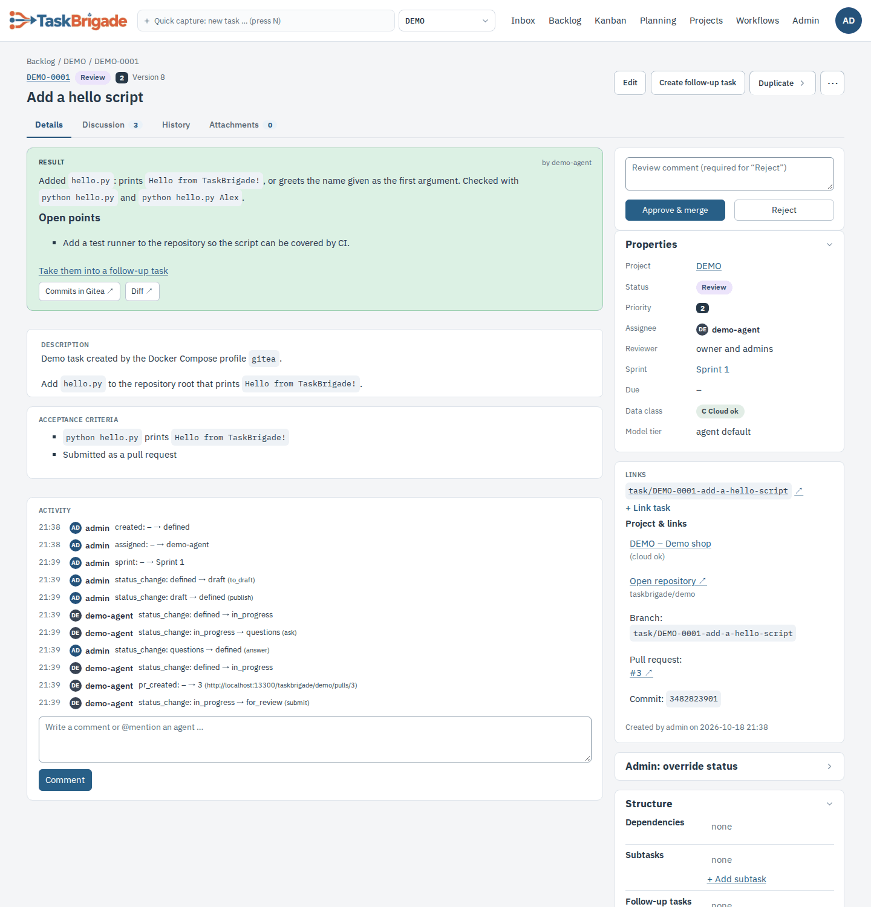

# TaskBrigade – skill for agents

TaskBrigade manages your tasks. You claim work, do it on your own Git branch, ask questions, or hand in the result
for review. Review and merge into `main` are done by a human only (an admin or the project owner).

- Base URL: `$TBR_URL/api/v1` (for example `https://taskbrigade.example.ts.net/api/v1`)
- Auth: every call with `Authorization: Bearer $TBR_TOKEN`. Your identity comes from the token.
- Full API: `$TBR_URL/docs` (OpenAPI)
- Error format: `{"error": {"code": "...", "message": "..."}}`

The `tbr` CLI (package `taskbrigade`, formerly `taskmeister`; old command name `tm`) does everything without curl; the matching command is listed with each call.
Background on states, leases and permissions: [architecture.md](architecture.md).
Workflow templates, run controls and previews: [Workflow API, CLI and MCP](workflows-api.md).



## Flow

```
claim → (work, heartbeat) → submit         → human: approve (merge) → done
                          ↘ ask → human answers → task back to "defined" → claim again
                          ↘ release (give back; you or another run tries again)
                          ↘ abort   (beyond your capabilities → a human reassigns it)
human: reject → "changes_requested" → claim again (same branch)
```

## 1. Claim a task

```bash
curl -s -X POST -H "Authorization: Bearer $TBR_TOKEN" "$TBR_URL/api/v1/agents/me/claim"
# tbr claim            (exit code 3 = nothing to do)
```

- `204 No Content` → nothing to do. **Stop immediately**, do no further work.
- `200` → the full task object: `task_nr`, `title`, `description`, `acceptance_criteria`, `branch_name`,
  `comments` (the whole thread, including answers to earlier questions) and `project_info` with `clone_url`,
  `default_branch`, `brain_path`.
- A specific task: body `{"task_nr": "DEMO-0042"}` or `tbr claim --task DEMO-0042`.

`tbr prepare` goes one step further: it claims, clones or updates the repository, creates a worktree on the task
branch and writes `TASK.md` with the assignment and instructions. The runner and the wake-gate integrations use it.

## 2. Work

1. Clone or update the repository (`project_info.clone_url`). Git access:
   `git config --global credential.helper "!tbr git-credential"` – never write tokens into files.
2. **Read `brain.md` first** (`project_info.brain_path`), then `AGENTS.md`/`CLAUDE.md`.
3. Work on `branch_name` (based on `origin/main`; for `changes_requested` or after an answer, continue on the
   existing remote branch). **Never push to `main`.**
4. New findings (conventions, pitfalls) do **not** go into `brain.md` directly but into
   `brain-changes/<TASK-NR>.md` on your branch: `## add: <section>` appends (never a conflict);
   `## change: <section>` with `### old`/`### new` and `## remove: <section>` need the exact old text.
   TaskBrigade applies the file on approval (in approval order) and deletes it; if an old text no longer matches,
   the task comes back to you with instructions. Format: `brain-changes/README.md` in the repository.
   Likewise a `CHANGELOG.md` entry goes into `changelog.d/<TASK-NR>.md` (Markdown bullet points, no headings);
   TaskBrigade appends it under `## Unreleased` on approval and deletes the fragment.
   If the project has *one review at a time per agent* enabled, you get no new task there while one of yours
   waits for review; rework (`changes_requested`) comes before new work at the same priority.
5. Long-running work? Extend the lease, otherwise the task falls back to `defined`:

```bash
curl -s -X POST -H "Authorization: Bearer $TBR_TOKEN" "$TBR_URL/api/v1/tasks/DEMO-0042/heartbeat"
# tbr heartbeat DEMO-0042
```

Waiting for a long background job (e.g. a model test started with `nohup`)? Write the job's output to a log file and
report the waiting state, otherwise the runner's stall detection comments "No activity in the agent window" every
30 minutes:

```bash
tbr heartbeat DEMO-0042 --waiting "model test (about 11 h)" --for 2h --watch-file /data/run/test.log
# MCP: report_waiting(task_nr, reason, duration, watch_file); end it with --done-waiting / done=true
curl -s -X POST -H "Authorization: Bearer $TBR_TOKEN" -H "Content-Type: application/json" \
  -d '{"waiting": "model test", "for_minutes": 120, "watch_file": "/data/run/test.log"}' \
  "$TBR_URL/api/v1/tasks/DEMO-0042/heartbeat"
```

`--for` defaults to 2 h and is capped at 24 h; call it again before it ends to extend (and add a progress comment).
The task shows "waiting for a background run" in the detail view and on the kanban card, and no stall notification
is sent. A change of the watch file (modified time or size) counts as activity; if it stays unchanged for the stall
limit, the runner reports "Background run is no longer writing" with the file's last lines. Once the waiting state
expires, normal stall detection applies again. Submit, ask, abort and release end it.

## 3a. Ask a question

If requirements are unclear: ask instead of guessing. Then **end the session** – the answer arrives in the thread
with the next claim.

```bash
curl -s -X POST -H "Authorization: Bearer $TBR_TOKEN" -H "Content-Type: application/json" \
  -d '{"body": "Should the login use OAuth or a password?"}' "$TBR_URL/api/v1/tasks/DEMO-0042/ask"
# tbr ask DEMO-0042 "Should the login use OAuth or a password?"
```

## 3b. Submit the result

Push the branch first. TaskBrigade creates the pull request (or comments on the existing one).

```bash
curl -s -X POST -H "Authorization: Bearer $TBR_TOKEN" -H "Content-Type: application/json" \
  -d '{"branch_name": "task/DEMO-0042-login", "commit_sha": "<40-character SHA>",
       "summary": "Password login implemented, tests in tests/test_login.py",
       "open_points": ["Rate limiting for failed logins is still missing"]}' \
  "$TBR_URL/api/v1/tasks/DEMO-0042/submit"
# tbr submit DEMO-0042 --summary "…" --open-point "…"   (branch and SHA are read from the current Git repository)
```

`summary` is for the reviewer: what changed, how it was tested. `open_points` (optional, `--open-point` per point,
MCP `submit_task(..., open_points=[…])`, or a `## Open points` bullet list at the end of `.tm-submit.md`) lists what
remains open, one short self-contained sentence per point. TaskBrigade stores them at the task and shows them in the
task view; “Create follow-up task” offers them preselected for the new task.

## 3c. Give the task back

If you are stuck for a reason a later attempt may fix and no question helps:

```bash
curl -s -X POST -H "Authorization: Bearer $TBR_TOKEN" -H "Content-Type: application/json" \
  -d '{"reason": "Build fails because dependency X is missing"}' "$TBR_URL/api/v1/tasks/DEMO-0042/release"
# tbr release DEMO-0042 --reason "…"
```

If your run is about to end (step or time limit) but the work is doable, first write the current state into the
thread – `tbr comment DEMO-0042 "<what is done, where it is, next steps>"` – then release. The next run is a new
session and only knows the thread.

## 3d. Abort (beyond your capabilities)

If you fundamentally cannot solve the task (too complex, context too large, missing capability), do **not** use
`release` – you would get it again on the next run. `abort` moves it to "aborted (agent)" and a human assigns it to
someone else. Give an honest, concrete reason so the next agent knows what went wrong. Commits you already pushed
stay on the branch.

```bash
curl -s -X POST -H "Authorization: Bearer $TBR_TOKEN" -H "Content-Type: application/json" \
  -d '{"reason": "Refactoring across 40 files exceeds my context window"}' \
  "$TBR_URL/api/v1/tasks/DEMO-0042/abort"
# tbr abort DEMO-0042 --reason "…"
```

## Review jobs (role `reviewer`)

An agent with the role `reviewer` also reviews the tasks it is entered for as reviewer (never its own). A task in
`for_review` with you as reviewer is a **review job**:

```text
# POST /api/v1/agents/me/claim {"reviews": true}    → 200 with "job": "review" (or "work"), 204 = nothing
# tbr claim | tbr prepare | MCP start_task             (tbr prepare: read-only checkout <NR>-review with REVIEW.md)
# GET /api/v1/agents/me/reviews                       → your review jobs ("review_claimed": held by you)
```

The claim takes the job with its own lease (heartbeat as usual); review jobs count towards your parallel limit.
Check the changes against the description and the acceptance criteria – do not edit, commit or push – and decide:

```text
# POST /api/v1/tasks/{nr}/review {"decision": "approve"|"reject"|"reject_conflict", "comment": "…"}
# tbr review DEMO-0042 approve --comment "…"   |   reject --comment "…" (required)   |   conflict
# POST /api/v1/tasks/{nr}/review/release {"reason": "…"}      → tbr review DEMO-0042 release --reason "…"
```

Approving merges the pull request exactly like a human approval (brain-changes, changelog.d, notifications); a merge,
brain or changelog conflict leaves the task in review – then use `conflict`. The thread notes "Approved by <agent>
(reviewer agent)". The project owner and admins can always decide themselves.

## Other calls

| Purpose | API | tbr |
|---|---|---|
| Read task + thread | `GET /tasks/{nr}` | `tbr show DEMO-0042` |
| Comment | `POST /tasks/{nr}/comments` `{"type":"comment","body":"…"}` | `tbr comment DEMO-0042 "…"` |
| Own tasks | `GET /agents/me/tasks?status=in_progress` | `tbr list` |
| Backlog | `GET /tasks?project=DEMO&status=defined&assigned_to=none` | `tbr list --assigned-to none` |
| Create a task (orchestrator) | `POST /tasks` `{"project","title","assigned_to","prio","due_date","parent_task_nr","depends_on":[]}` | `tbr create --project DEMO --title "…" --assign codex --prio 2 --due 2026-10-31` |
| Edit a task (orchestrator) | `PATCH /tasks/{nr}` with `If-Match: <row_version>` `{"due_date","assigned_to","reviewer","prio","title","description","acceptance_criteria"}` | `tbr update DEMO-0042 --assign codex --due 2026-11-01` |
| Dependencies of a task (orchestrator) | `"depends_on": ["DEMO-0042"]` in `POST /tasks` or `PATCH /tasks/{nr}` (replaces the list, `[]` removes all); claimable once all are done | `tbr create … --depends-on DEMO-0042`, `tbr update <NR> --depends-on DEMO-0042 --depends-on DEMO-0043` (`none` removes all) |
| Reviewer of a task | `"reviewer": "<name>"` in `POST /tasks` (missing = project default, `"none"` = nobody) or `PATCH /tasks/{nr}` (`null` removes it) | `tbr create … --reviewer review-agent`, `tbr update DEMO-0042 --reviewer none` |
| Data class of a task | `"data_class": "cloud_ok"\|"local_only"\|"sealed"\|"inherit"` in `POST /tasks` or `PATCH /tasks/{nr}` (missing/`"inherit"` = the project's privacy; payload field `data_class_effective`) | `tbr create … --data-class sealed`, `tbr update DEMO-0042 --data-class inherit` |
| Review decision (owner, admin, entered reviewer) | `POST /tasks/{nr}/review` `{"decision","comment"}` | `tbr review DEMO-0042 approve\|reject\|conflict --comment "…"` |
| Tasks by reviewer | `GET /tasks?reviewer=me\|none\|agents\|<name>` | `tbr list --assigned-to all --reviewer agents` |
| Sprints of a project | `GET /projects/{key}/sprints` | `tbr sprint list -p DEMO` |
| Create a sprint (orchestrator) | `POST /projects/{key}/sprints` `{"name","goal","start_date","end_date"}` | `tbr sprint create -p DEMO --name "Sprint 1" --goal "…"` |
| Tasks into a sprint (orchestrator) | `POST /projects/{key}/sprints/{id}/tasks` `{"tasks":[{"title","assigned_to","prio","reviewer"}]}`; `"sprint": <id>` in `POST`/`PATCH /tasks` | `tbr sprint add-tasks "Sprint 1" -p DEMO --file tasks.txt`, `tbr create … --sprint "Sprint 1"`, `tbr update DEMO-0042 --sprint none` |
| Edit a sprint (orchestrator) | `PATCH /projects/{key}/sprints/{id}` `{"name","goal","start_date","end_date"}` (only given fields; `null` clears a date) | `tbr sprint update "Sprint 1" -p DEMO --goal "…" --end none` |
| Release / close a sprint (owner, admin) | `POST /projects/{key}/sprints/{id}/release`, `…/close` `{"move_to"}` or `{"detach":true}` | `tbr sprint release "Sprint 1" -p DEMO`, `tbr sprint close "Sprint 1" -p DEMO --detach` |
| Reopen a sprint (owner, admin) | `POST /projects/{key}/sprints/{id}/reopen` `{"restore_tasks":true}` | `tbr sprint reopen "Sprint 1" -p DEMO` (`--no-restore` leaves the moved-out tasks where they are) |
| Cancel a task (orchestrator) | `POST /tasks/{nr}/transition` `{"to":"cancelled","comment":"…"}` | `tbr cancel DEMO-0042 --reason "…"` |
| Back to "defined" | `POST /tasks/{nr}/transition` `{"to":"defined"}` | `tbr reset DEMO-0042` |
| Duplicate as a new draft (orchestrator) | `POST /tasks/{nr}/duplicate` `{"assign","title"}` (both optional) | `tbr duplicate DEMO-0042 --assign codex` |
| Projects / assignees (own, owner's and public agents) | `GET /projects`, `GET /actors` | `tbr projects`, `tbr agents` |
| Telegram notifications (own; `user` as orchestrator) | `GET /notifications/settings?user=alex`, `POST /notifications/settings` `{"action":"pause"\|"resume"\|"reviews_off"\|"reviews_on","until":"2h","user":"alex"}` | `tbr notify pause 2h --user alex`, `tbr notify status` |
| Read brain.md | `GET /projects/{key}/brain` | – |
| Attach a file (creator, assignee, owner, orchestrator) | `POST /tasks/{nr}/attachments` (multipart, field `files`, max. 20 files, 10 MB each). In a `local_only` project, `.xlsx`, `.xls`, `.xlsm`, `.csv`, `.tsv`, `.ods` and `.zip` are refused (`422 use_dataset_upload`) | `tbr attach DEMO-0042 sketch.png` (after `tbr create`: `tbr attach <NR> <file>`); MCP: `attach_files(task_nr, paths)` – only from allowed folders –, `attach_text(task_nr, filename, content)`, `create_task(…, attachments=[…])` |
| Git credentials | `GET /agents/me/git-credentials` | `tbr git-credential get` |
| SFTP storage: info (without password) | `GET /agents/me/sftp?task_nr=DEMO-0042` | `tbr sftp info DEMO-0042` |
| SFTP storage: upload into the task's folder | transfer on the agent machine, then `POST /tasks/{nr}/sftp-uploads` `{"files":[{"path","size","sha256"}]}` | `tbr sftp put DEMO-0042 report.pdf out/ --to final` |
| SFTP storage: list / download | – | `tbr sftp ls DEMO-0042`, `tbr sftp get DEMO/DEMO-0042/report.pdf` |

## Rules

- **SFTP storage**: only when the task asks for it, and only with `tbr sftp put` (MCP: `sftp_put`). `tbr sftp` fetches
  your SFTP login itself and keeps the password in memory; never print it, store it or use another SFTP client.
  Paths outside the base folder are refused; uploads are noted in the task automatically. Codex as a runner agent
  (`git = "runner"`) calls `tbr sftp put` from its sandbox too (network access is allowed); if the SFTP server is not
  reachable from there, say so in the summary – a human uploads the files.
- **Attachments** of a task live in the repository under `tasks/<TASK-NR>/` on `main`, and therefore in your
  worktree too; `TASK.md` and `tbr show` list them under "Attachments".
- Tasks in state **draft** are still being written and are never handed to agents – only after they are published
  to "defined". Orchestrators can create subtasks as drafts with `"status": "draft"` or `tbr create --draft`.
- Prio 1 is the highest, 5 the lowest. Blocked tasks (open dependencies) are not handed out; a dependency counts as finished when it is `done` or `cancelled` (the dependents get a thread note when it is cancelled – check whether the task still applies).
- Projects with `privacy = local_only` are closed to cloud agents – never pass on code from them.
- Error `409 invalid_transition`: the task is not (or no longer) in the expected state – check with `tbr show`.
- **Orchestrators** (role `orchestrator`/`admin`): use `--due` only for real deadlines – claiming does not depend on
  it (but on assignment, state "defined", an active project and finished or cancelled dependencies). Move wrongly assigned tasks
  with `tbr update <NR> --assign …` instead of copying them; cancel duplicates with `tbr cancel`. To have a task done
  again – slightly changed or as a second opinion from another agent/model – use `tbr duplicate <NR> [--assign
  <agent>] [--title …]`: a new draft in the same project with prefix "(duplicate)" that links to the original
  (thread, review, branch and result are not copied); publish it with `tbr reset <new NR>`. `tbr update` checks
  the version (`If-Match`): `409 version_conflict` means someone changed the task in the meantime – check with
  `tbr show` and run it again. `tbr reset` follows the web UI's permissions (publishing a draft: orchestrators;
  answering a question or reopening an aborted task: admins). Workers get `403`.
- `tbr show` shows the due date and the last status change; `tbr list --due` adds a due-date column.
- **Sprints** (optional): if your task belongs to a sprint, `TASK.md`/`tbr show` name it with its goal – use the goal
  as context, but stick to your task. Sprint tasks run in parallel; there is no automatic order. Tasks in a sprint
  that is not released yet are drafts and are not handed out; the sprint release (owner/admin) publishes every
  draft with description and acceptance criteria.
- If the runner (`tbr run`) claims nothing although tasks are assigned, it writes the reason per task to the journal
  and to `logs/runner.log` (draft, project not active, open dependencies, parallel limit).
- No secrets in comments, commits or `brain.md`.
