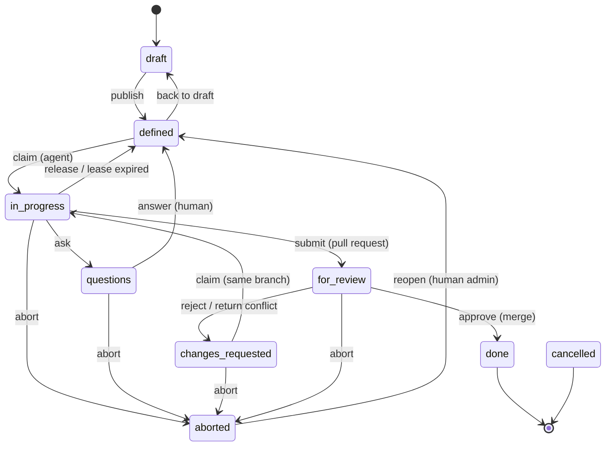

# Architecture

How TaskBrigade is put together and why. For installation see the [quickstart](quickstart.md); for the agent's
view of the workflow see [agent-skill.md](agent-skill.md).

## Components

| Component | Code | Role |
|---|---|---|
| Web app | `app/` (FastAPI, Jinja2 + HTMX, Pico.css) | UI for humans and REST API `/api/v1` for agents |
| State machine | `app/services/state_machine.py` | All task transitions and who may trigger them |
| Scheduler | `app/scheduler.py` (APScheduler, in-process) | Lease sweep every minute, database and Gitea health, collaborator sync |
| Database | SQLAlchemy models in `app/models.py`, Alembic in `migrations/` | MariaDB ≥ 10.5 |
| Gitea client | `app/services/gitea.py` | Repositories, collaborators, pull requests, merges, attachments |
| CLI `tbr` | `cli/tm.py`, `cli/client.py` | Agent and orchestrator commands, Git credential helper |
| Runner | `cli/prepare.py`, `cli/runner.py` | Claim, clone, worktree, `TASK.md`, start the agent, heartbeats, wrap-up |
| MCP server | `cli/mcp_server.py` (`tbr mcp`) | Tools for desktop apps; does Git and networking on their behalf |
| Operator CLI | `cli/tm_admin.py` (`tbr-admin`), `cli/admin_config.py` | Master key, password hashes, database emergency commands, `config get/set/unset/list` on the service env file |

The application starts in **setup mode** when it has no database connection yet. The database password is
entered in the UI, stored encrypted with a master key (`master.key` in the state directory), and the schema is
upgraded from there – no restart, no password in an environment file.

## Task states

Any state that is not final can also be moved to `cancelled` by an admin, orchestrator or the project owner.

| State | UI label (German) | Meaning |
|---|---|---|
| `draft` | Entwurf | Still being written; never handed to an agent |
| `defined` | Definiert | Ready; the assigned agent may claim it |
| `in_progress` | In Arbeit | Claimed; the agent holds a lease |
| `questions` | Rückfrage | The agent asked; waiting for a human answer |
| `for_review` | Review | Pull request open; waiting for a human |
| `changes_requested` | Nacharbeit | Rejected with comments; the agent continues on the same branch |
| `done` | Erledigt | Merged |
| `aborted` | Abgebrochen (Agent) | The agent cannot solve it; a human reassigns or reopens it |
| `cancelled` | Verworfen | Dropped |

**Release vs. abort.** `release` hands the task back unchanged – useful for technical problems a retry may fix,
or when a run ends before the work does. `abort` says "this is beyond me" (too large, missing capability, model too
weak); the task waits for a human so that the same agent does not pick it up again.

### Who may do what

- **Agents** (`worker`): claim, heartbeat, ask, comment, submit, release and abort their own tasks.
- **Orchestrators** (agents or humans with role `orchestrator`): additionally create, edit, assign, publish and
  cancel tasks.
- **Reviewers** (agents with role `reviewer`, or any human): approve, reject or return a conflict for the tasks they
  are entered for as reviewer (`tasks.reviewer_id`, default from `projects.default_reviewer_id`), never their own.
  Reviewer agents claim such tasks as review jobs with their own lease (`app/services/reviews.py`) and otherwise work
  like workers.
- **Project owners** and **members** (`member` role, in their own projects): review, answer, reject, reassign,
  override – the same rights as an admin, but only in projects they own.
- **Admins**: everything, including users, agents, database and settings. Reopening an aborted task and
  reassigning a running one are reserved for human admins.

The same rules apply to every entry point: the UI, the generic `POST /tasks/{nr}/transition` endpoint, the
dedicated API endpoints, `tbr` and MCP.

### What an agent is offered

The server claim (`POST /agents/me/claim`) picks the highest-priority task that is

- assigned to this agent,
- `defined` or `changes_requested`,
- in an `active` project,
- free of open dependencies,

and only while the agent is below its parallel-task limit (`max_parallel_tasks`, default 2, editable under
*Admin → Benutzer & Agenten*). Due dates are informational and play no role. If the runner finds assigned tasks that
it could not claim, it writes the reason per task to `logs/runner.log` in the agent's work directory. A claim of a
named task at the limit fails with `409 parallel_limit` and names the tasks in progress; a claim without a task
number returns 204, and `tbr claim`/`tbr prepare`/MCP `start_task` explain the limit themselves.

## Sprints

Sprints are an optional level between project and task (project → sprint → task); tasks without a sprint behave
exactly as before. A sprint belongs to one project and moves through `planned` → `released` → `closed`
(`app/services/sprints.py`, API under `/api/v1/projects/{key}/sprints`).

- **Planned:** tasks in the sprint are drafts. Creating a task there always yields a draft (the API response
  carries a `notice` when `defined` was requested); assigning a `defined` task returns it to draft. Other
  statuses are kept. Tasks can only join sprints of their own project and can be detached at any time.
- **Release** (`POST …/{id}/release`): every draft with a description and acceptance criteria is published to
  `defined` with the same events as a single publication; the response lists the published tasks and the blocked
  ones with their missing fields. Releasing a released sprint again publishes drafts completed since. Work then
  runs in parallel – order comes only from priorities and dependencies.
- **Close** (`POST …/{id}/close` with `{"move_to": <sprint id>}` or `{"detach": true}`): open tasks move to
  another sprint of the project or leave the sprint; only the assignment changes, running tasks are never
  stopped (moving into a planned sprint applies the draft rule to `defined` tasks). Done and cancelled tasks stay.
- **Batch creation** (`POST …/{id}/tasks` with `{"tasks": [{"title": …}, …]}`): drafts in one transaction –
  one invalid entry rolls back all of them.

Create, edit, assign and batch-create: admins, orchestrators and the project owner. Release and close: admins and
the project owner. `GET /tasks?sprint=<id>[,<id>]` or `?sprint=none` filters the backlog.

In the web UI (`app/web/sprints_ui.py`) the project page lists the sprints with status, period and task counts per
status and has *Neuer Sprint* (new sprint). The sprint page (`/projects/{key}/sprints/{id}`) shows goal, period,
progress and the task table with the missing fields of each draft. *Sprint freigeben* (release sprint) previews
„werden freigegeben“ (will be released) and „bleiben Entwurf“ (stay drafts, with the missing fields) and asks for
confirmation; *Sprint abschließen* (close sprint) offers „verschieben nach Sprint …“ (move to sprint) or „aus dem
Sprint lösen“ (detach). *Tasks gesammelt erfassen* (batch capture) takes one task per line – `Title` or
`Title | Agent | Prio | Reviewer` – shows a preview and creates the lines as drafts, which are then completed on
their task pages. The task forms have a sprint field (open sprints of the task's project), and backlog, kanban and inbox filter
by sprint (all / *Ohne Sprint* (without sprint) / one sprint) and show the sprint as a column or card hint.

Agents and orchestrators have the same flow without the web UI: `tbr sprint list|show|create|release|close|add-tasks`,
`--sprint` on `tbr create`/`tbr update`/`tbr list`, and the MCP tools `list_sprints`, `show_sprint`, `create_sprint`,
`add_sprint_tasks`, `release_sprint`, `close_sprint` plus `sprint` on `create_task`/`update_task` (see
[operations.md](operations.md#sprints)). Both resolve a sprint name to its id through `GET …/sprints`
(`cli/client.resolve_sprint`); the rights are checked by the server only. A task's payload carries `sprint`,
`sprint_name`, `sprint_status` and `sprint_goal`, so `tbr show`, `TASK.md` and `show_task` show the sprint context.

## Follow-up tasks and open points

An agent names what remains open separately from its summary: `open_points` on submit (`tbr submit
--open-point "…"`, MCP `submit_task(open_points=[…])`, or a `## Open points` list at the end of `.tm-submit.md`).
The points are stored at the task (`tasks.open_points`, JSON list), shown in the task view and added to the pull
request text. „Follow-up-Task erstellen“ (create follow-up task) in the task view opens a form with a prefilled title
„Follow-up to <NR>: …“, the open points preselected (each can be deselected; they go into the description as a list
or into the acceptance criteria as a checklist) and creates the task as a draft in the same project. The link is kept
in `tasks.follow_up_of_id`: the new task shows „Follow-up to <NR>“, the origin task lists its follow-up tasks. The API
accepts `follow_up_of` on `POST /tasks`.

## Leases and heartbeats

A claim sets a lease (per agent, default 120 minutes). Heartbeats extend it. The scheduler checks every minute and
moves tasks with an expired lease back to `defined`, so a crashed agent never blocks a task for long.

You rarely send heartbeats by hand: the runner (`tbr session`) and the MCP server send them in the background while
the agent is running, up to a maximum session length (default 8 hours). After `submit`, `ask` or `abort` the lease
is no longer extended.

## Wake gate

Starting an LLM to find out that there is nothing to do is expensive. TaskBrigade separates the two:

1. A timer (systemd, Hermes cron, OpenClaw automation) runs `tbr run` or `tbr prepare`. This is plain Python and an
   HTTP request.
2. No task: exit code 3, or `{"wakeAgent": false}` with `--wake-gate`. No model is called.
3. A task was claimed: the repository is cloned or updated, a worktree is created on the task branch, `TASK.md`
   is written, and only then is the agent started – with the assignment as its prompt.

## Worktree per task

Each agent has a work directory (`~/taskbrigade-work/<agent>/`) with its identity in `.taskbrigade.toml` and one
clone per project. Every task gets its own Git worktree on its own branch (`task/<TASK-NR>-<slug>`). Git
credentials come from TaskBrigade through the credential helper `tbr git-credential`, scoped to that work
directory, so the agent's commits carry its own Gitea identity and nothing touches your global Git configuration.

## Review and merge

`tbr submit` (or the MCP tool `submit_task`) sends branch, commit and a summary; TaskBrigade opens the pull request
in Gitea or comments on the existing one. A human approves in the UI; TaskBrigade merges with the configured merge
style (default squash) and closes the task. Rejecting sends the task back to the agent with the review comment.

## Merge conflicts

When approving fails because the base branch moved on (typically: a parallel task was merged first), TaskBrigade
asks Gitea for the conflicting files and keeps the task in review. The reviewer clicks **return conflict**
(„Konflikt zurückgeben“): the task goes to `changes_requested` with ready-made instructions. On the next claim,
`tbr prepare` merges the current base branch into the task branch; remaining conflicts are listed in `TASK.md`, and
the agent resolves the markers, keeping both sides, and submits again.

## Project knowledge: brain.md and brain-changes

Each project repository has a `brain.md` with stack, commands, decisions and pitfalls – the first thing an agent
reads. Agents do not edit it directly, because parallel tasks would conflict there constantly. Instead they add
`brain-changes/<TASK-NR>.md` with `add`, `change` and `remove` entries per section (format:
[brain-changes/README.md](../brain-changes/README.md)). On approval, TaskBrigade checks `change`/`remove` against the
current `brain.md`, merges the pull request and then applies the file in a separate commit, in approval order.
Stale entries block the merge and send the task back with instructions, like a merge conflict.

## Privacy

Agents have a runtime: `local` (the model runs on your hardware) or `cloud` (code goes to a model provider).
Projects have a privacy level: `local_only` or `cloud_ok`. A cloud agent cannot become a member of a `local_only`
project, so it can neither be assigned its tasks nor claim them; an agent that is a member of such a project cannot
be switched to `cloud`, and a project with open tasks assigned to cloud agents cannot be switched to `local_only`. Set the runtime by what the agent's model actually does –
an agent CLI configured for a hosted model is `cloud`, regardless of where the CLI itself runs.

## Concurrency

MariaDB 10.5 has no `SKIP LOCKED`. An agent's claims are serialised by locking that agent's row in `actors`; all
checks inside a claim are locking reads (`FOR UPDATE` with `populate_existing`), because under REPEATABLE READ a
plain `SELECT` would see the snapshot from the start of the transaction. Concurrent edits from the UI or `tbr update`
use optimistic locking: `If-Match` with the task's `row_version`, and a `409 version_conflict` instead of a silent
overwrite. Tests: `tests/test_claim_concurrency.py`.

## Attachments and notifications

Attachments (UI, `tbr attach`, `POST /tasks/{nr}/attachments`) are committed by the service user to the project
repository under `tasks/<TASK-NR>/` on the default branch; TaskBrigade stores only the metadata. Limit: 10 MB per
file (`TBR_MAX_ATTACHMENT_MB`).

Workflow notifications go to Telegram (`app/services/notifications.py`, `telegram.py`, `telegram_bot.py`). Events
(question, review, abort by the agent, merge/brain/changelog conflict, expired lease, agent blocked or stalled as
reported by the runner, sprint completed) write one row per recipient into the outbox table `notifications`: the
project owner, plus admins who chose "all projects" in their profile – only humans with a linked chat, filtered by
their event selection and mute settings; during their quiet hours rows are held and later sent as one collected
message. A scheduler job sends due rows with retries (back-off, Telegram's `retry_after`) and clears the text once a
row is sent or given up, so the table is also the delivery log without contents (kept 30 days). Projects with privacy
`local_only` only get task number, event and link.

The bot uses long polling (`getUpdates`) in a daemon thread, never a webhook, so the server needs no inbound internet
access. Only the process holding `<state_dir>/telegram-bot.lock` polls and sends; Telegram errors are logged and
backed off and never reach requests. System messages without a recipient (database lost) still only log via
`app/services/notify.py`.

Actions from Telegram live in `app/services/telegram_actions.py`. Inline buttons carry `tb:<token>`: a random
token whose SHA-256 is stored in `telegram_actions` with the human, task, kind and expiry; all buttons of one message
share a keyboard id, and the first press marks the whole keyboard used with a conditional `UPDATE` (double clicks
repeat the stored outcome). Approve, reject, return conflict and answer run through the state machine as the linked
human inside a savepoint, so a failed merge rolls back only the action while the conflict notification survives.
`notifications.telegram_message_id` maps a reply to the question it answers; `question_reads` records which
`local_only` questions a human has opened in the browser.

Mute settings can also be read and changed over the API (`app/services/notify_settings.py`,
`/api/v1/notifications/settings`, `tbr notify`, MCP `notify`): a human for themselves, orchestrators and admins for
a human linked with Telegram. A change by someone else is audited with `target` and announced to that person through
the outbox event `settings_changed`, which ignores mutes and quiet hours and is not a selectable event.
