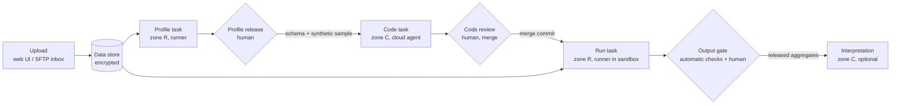

# Data zones

Data zones let frontier models analyse confidential tabular data (accounting exports, client lists) **without the
raw data leaving your network**. A cloud model only ever sees a schema, a synthetic sample and – after a human
released them – aggregates. It writes code; the code runs locally in a sandbox without a language model and without
network. This page is the overview: what was built, how the parts fit together and who does what. The details live
in the guides linked from each section. UI labels are the English ones; with `UI_LANGUAGE=de` the menu *Data* is
called *Daten*.

The feature is **opt-in**. Without it, TaskBrigade still knows the data classes and the model location of agents
(they protect `local_only` projects), but there is no data store, runner or output gate.

## Code instead of data

Between the zones only **references** (dataset key, profile and result ids, commit SHA) and **released artifacts**
(profile, result) travel – never raw data. Every zone crossing is either a human decision (profile release, code
review, output gate) or a draft a human has to release.

## Zones and data classes

| Class | Zone | Badge | Who may work on the task / see its content |
| --- | --- | --- | --- |
| `cloud_ok` | C | “C Cloud ok” | every agent, also with a cloud model |
| `local_only` | L | “L Local only” | agents whose model runs locally, and humans |
| `sealed` | R | “R Sealed” | runners (no model) and humans with the data right; **never an LLM** |

Every task has a class: by default it inherits the project's privacy (`local_only` or `cloud_ok`); a task can set a
stricter one at any time and a looser one only by the project owner or an admin (audited). Once work has started the
class can only get stricter. Runner tasks are always `sealed`, and a task that takes a dataset as input is `sealed`
too. Full rules, error codes and badges: [architecture.md → Data class per task](architecture.md#data-class-per-task).

Spreadsheet and archive attachments (`.xlsx .xls .xlsm .csv .tsv .ods .zip`) are refused in zones L and R
(`422 use_dataset_upload`), because attachments are committed to the repository and the repository is cloned by
cloud agents. Real data goes through *Data → + Upload* instead.

## Agents: runtime, model location, runner

For privacy it matters where content goes for inference, not where the agent process runs. Every actor therefore has
two fields: **runtime** (`local`/`cloud`, where the process runs) and **model location** (`cloud`, `local` or
`none`). Claude Code and Codex are fixed to `cloud`; for OpenCode, Hermes, OpenClaw and `other` an admin sets the
model location in *Admin → Users & agents* and confirms a local model explicitly. The zone an agent may serve follows
from both ([architecture.md → Privacy](architecture.md#privacy)):

| Model location | Runtime | May work on |
| --- | --- | --- |
| `cloud` | any | `cloud_ok` |
| `local` | `local` | `cloud_ok`, `local_only` |
| `local` | `cloud` | `cloud_ok` |
| `none` (runner) | `local` | only `profile`/`run` tasks, class `sealed` |

The **runner** is a deterministic service without a language model on the TaskBrigade host: an agent of kind
`runner` (role worker, model location `none`) that claims only `profile` and `run` tasks, while LLM agents never get
those. It is never a reviewer or project owner and never sends output contents into a task thread.

## The parts

| Part | What it does | Guide |
| --- | --- | --- |
| Data store | Datasets encrypted outside Gitea (KEK + one DEK per dataset, AES-256-GCM), streamed web upload, retention with crypto-shredding, emergency download | [data-store.md](data-store.md) |
| Data audit | Append-only, SHA-256 hash-chained log of every data decision and read, without values or dataset names; `tbr-admin data audit verify` | [data-store.md → Data audit](data-store.md#data-audit) |
| SFTP inbox | Native OpenSSH `internal-sftp` chroot per deliverer; a path unit imports finished files into the store | [data-store.md → SFTP inbox](data-store.md#sftp-inbox-native) |
| Schema profiler | Runs automatically in the sandbox after each CSV/TSV/XLSX upload; schema, synthetic sample, fingerprint; human profile release with aliases | [data-store.md → Schema profiles](data-store.md#schema-profiles-and-release) |
| Runner and sandbox | `taskbrigade-runner.service` claims run tasks and starts one `taskbrigade-job@<job>.service` per job: no network, own user, memory/CPU/time limits | [operations.md → Data-zone runner](operations.md#data-zone-runner) |
| Output gate | Automatic checks 1–9 on every result, release view with four-eyes rule, optional Laplace noise and query/epsilon budgets per dataset | [data-store.md → Output gate](data-store.md#output-gate) |
| Task chain | `task_data_refs` instead of contents, follow-up drafts at every zone change, chain view, approved artifacts inline in TASK.md | [data-store.md → Task chain](data-store.md#task-chain-across-zones) |
| Local-model read access | Agents with a local model may read `local_only` datasets of their project over the API (audited) | [data-store.md → Agent read access](data-store.md#agent-read-access) |
| Gitea push guard | Optional pre-receive hook that refuses spreadsheet/archive files in data-zone repositories | [operations.md → Gitea push guard](operations.md#gitea-data-zone-push-guard-native-installation) |
| Docker variant | Compose profiles `data` and `data-sftp`: runner container, one job container per run with `network_mode: none` | [docker.md → Data zones](docker.md#data-zones-profiles-data-and-data-sftp) |
| Workflows | `runner`, `gate` and `script` steps run the same chain repeatedly; the gate stays a human decision | [workflows.md](workflows.md) |

## A walk-through

1. **Upload.** A project member with the data right opens *Data → + Upload*, picks the project, a name, the class
   (`sealed` – runner only, or `local_only` – local models may read), optionally *Replaces* and a retention. The
   file is encrypted as it arrives; nothing is written to Git or `/tmp`. An SFTP deliverer's file lands the same
   way. The dataset is named only by its key (`DS-0003`) outside the *Data* menu.
2. **Profile.** CSV/TSV/XLSX uploads create a sealed `profile` task. The runner parses the file in the sandbox and
   produces a schema (rounded ranges, categories only when frequent enough, no values of identifier/PII columns)
   and 20 synthetic rows per sheet that contain no source value.
3. **Release the profile.** On *Data → dataset → Schema profile* a person with the data right (not the uploader of a
   sealed dataset) checks column and sheet names, sets aliases where a name is itself confidential, and chooses
   **Release profile and propose code task** or **Reject profile**.
4. **Write the script (zone C).** The release creates a **draft** “Write analysis script for DS-…” with the released
   schema and sample inline; TASK.md adds the script contract (input from `TBR_INPUT`, output `result.json` in
   `tbr-aggregate/1`, exit code 3 for a schema mismatch). Release the draft and assign a cloud agent; it develops and
   tests the script against the synthetic sample. A human reviews and merges as usual.
5. **Run it (zone R).** Approving the code task creates the draft “Run script on DS-…” with the merge commit and the
   script path. Released, the runner fetches exactly that commit (only merged commits of approved tasks of the same
   project run), pre-checks it, decrypts the input into the job's tmpfs and runs it in the sandbox. Outputs and logs
   go encrypted into the quarantine.
6. **Output gate.** The checks run (format, size, minimum group size k, no identifier values, no raw rows; warnings
   for free text, dominance and differencing; rounding). A passing result waits in *Inbox → Data releases*. A person
   with the data right who neither created the run task nor merged the script chooses **Release – data leaves zone
   R**, **Reject** or **Keep in zone R**. Decisions are web-only – never Telegram, never an agent token.
7. **Interpret (zone C, optional).** The release creates the draft “Interpret result #…”; its agent gets the released
   aggregate inline in TASK.md.

Monthly repetition of the same chain is a [workflow](workflows.md#agent-once-then-runner): later runs reuse the
reviewed script without a new code task as long as the schema fingerprint matches.

## Rights

| Who | May |
| --- | --- |
| Project members | see the dataset list and metadata (name, size, status), released profiles and results of their project |
| Project owner, admins, members with the **Data right** | upload, see unreleased profiles, release profiles and results, work on `sealed` tasks |
| Project owner, admins | delete datasets; change the output policy (noise, budgets) and the project's four-eyes rule |
| Admins with the data right | emergency download of raw data (reason required, audited) |
| Agents with a local model | read `local_only` datasets of their projects over the API (audited) |
| Cloud agents | nothing in the store; released artifacts only through an open task of their own that references them |
| Runners | the input of the job they are running, nothing else |

The data right is granted in *Admin → Users & agents → \<human\>*. The menu *Data* appears when the data store is
enabled and the human has the data right, owns a project or is an admin.

## For admins

**Switch on.** Native: `sudo deploy/update.sh TBR_DATA_ZONES=1` (add `TBR_DATA_SFTP=1` for the SFTP inbox); it creates
the users `tbr-runner` and `tbr-job`, the group `tbr-data`, the store folders, the KEK, the runner venv, the units and
the polkit rule, idempotently ([operations.md → Data zones](operations.md#data-zones-installation-and-migration)).
Docker: the compose profiles `data` and `data-sftp` ([docker.md](docker.md#data-zones-profiles-data-and-data-sftp)).
Then:

1. *Admin → Settings*: tick “Data store enabled (menu Data: encrypted dataset upload)”.
2. *Admin → New agent* with kind **runner**; run the join command shown there on the host
   (`tbr-admin runner join …`, then `tbr-admin runner check` and `tbr-admin runner selftest`). Add the runner to the
   projects that hold datasets.
3. Grant the **Data right** to the people who upload and release.
4. Check *Model location findings* on *Admin → Settings* and switch on “local_only only for agents with a local model
   (model location instead of runtime)” – it is on for new installations and off after an upgrade until the findings
   are cleared.

**Settings** (*Admin → Settings*, stored in the database):

| Label | Key | Default |
| --- | --- | --- |
| Data store: maximum upload size (MB) | `data_max_upload_mb` | 200 |
| Data store: default retention (days) | `data_retention_days` | 90 |
| Data runner: memory limit per job (MB) | `runner_memory_mb` | 4096 |
| Data runner: CPU limit per job (percent, 100 = one core) | `runner_cpu_percent` | 200 |
| Data runner: time limit per job (seconds) | `runner_timeout_s` | 900 |
| Output gate: minimum group size k (a dataset may set its own) | `gate_min_group_size` | 5 |
| Output gate: maximum rows per result table | `gate_max_rows` | 1000 |
| Output gate: dominance threshold (percent of a group's sum) | `gate_dominance_pct` | 85 |
| Output gate: dominance is a hard check (refuse instead of warn) | `gate_dominance_hard` | off |
| Output gate: four-eyes rule by default (projects can change it) | `data_four_eyes` | on |

After changing the runner limits natively, run `tbr-admin runner limits --write` (or `deploy/update.sh`) so the
sandbox drop-in follows. Paths (`TBR_DATA_DIR`, `TBR_DATA_KEY_FILE`, `TBR_RUNNER_VENV`, `TBR_SFTP_DIR`) are service
settings set with `tbr-admin config set`.

**Backups.** Back the KEK (`/etc/taskbrigade/data.key`) up separately from the database and from `TBR_DATA_DIR`.
`deploy/backup.sh` copies the encrypted store with `TBR_BACKUP_DATA=1`, never the KEK. Deleting a dataset drops its
DEK, so every copy – also in backups – becomes unreadable.

**Tests of the isolation.** `tbr-admin runner selftest` on the host, `deploy/sandbox-test/run.sh` in a throwaway
systemd container, `deploy/docker/data-zones-test.sh` for the Docker variant and `deploy/sftp/check-inbox.sh` for the
SFTP drop-in. None of them needs real data.

## Security model

The security boundary is the **sandbox, the output gate and the human releases** – not the care of a model. Static
pre-checks of scripts, the profile rules and the instructions in TASK.md are additional layers.

| Risk | Countermeasures as built | Residual risk |
| --- | --- | --- |
| Exfiltration by the script over the network | sandbox without network (`PrivateNetwork`, `IPAddressDeny`, `RestrictAddressFamilies=AF_UNIX`; Docker `network_mode: none`), static pre-check, only merged commits of approved tasks run | low |
| Exfiltration through the output | fixed format `tbr-aggregate/1`, minimum group size, identifier and raw-row probes in a separate sandbox job, free-text warning, rounding, human release with the full output in view; optional noise and budgets | medium – a creative encoding is not fully detectable automatically |
| Re-identification from aggregates | k ≥ 5, dominance check, differencing warning, four-eyes rule, query/epsilon budgets per dataset | medium; budgets count per dataset id, not across copies |
| Leak through the profile | categories only when frequent, no identifier values, rounding, aliases, profile release before zone C | low |
| Leak through logs | stdout/stderr only encrypted in the quarantine; the task thread gets exit code and runtime; journald only unit status | low |
| Misconfigured agent | model location defaults to `cloud`, fixed for Claude Code/Codex, explicit confirmation for `local`, findings list | medium for `local_only` texts, low for datasets |
| Misconfigured class | attachment lock, loosening only by owner/admin with audit, “dataset input ⇒ sealed” | medium (copy and paste by humans stays possible) |
| Data in Git | attachment lock, optional Gitea push guard, synthetic samples only | low to medium |
| Sandbox escape, malicious spreadsheet | systemd hardening, own job user, system call filter, profiler in the sandbox, `defusedxml` and size caps; KEK and store inaccessible | low |
| Theft of storage or backups | ciphertext per file, KEK kept apart, crypto-shredding | low |
| Compromised app server (root) | out of scope; the audit hash chain makes later manipulation visible | high, unchanged |
| Insider release | four-eyes rule, web-only decisions, audited note, “data leaves zone R” | medium (organisational) |
| Notifications | zone R is treated like `local_only`: task number, event and link only | low |

## Deviations from the concept

The design record is the German concept `research/konzept-datenzonen.md` in the development repository
(it is not part of the public export); code comments cite its sections. What was built differs in these points:

- **Admin pages.** There is no separate *Admin → Data zones* page: the settings live in *Admin → Settings*, the
  model-location findings there too, SFTP deliverers are managed with `tbr-admin data sftp-user` only.
- **Stricter than planned.** Released profiles and results are required for every LLM zone (C and L), not only zone C;
  checks 4 and 5 of the gate run in a separate sandbox job instead of the runner process; profile releases follow the
  four-eyes rule for sealed datasets; `authorized_keys` lines of SFTP deliverers are additionally `restrict`ed.
- **Added.** Result status `kept_sealed` (*Keep in zone R*, also used by workflows without a gate), optional
  differential-privacy noise and query/epsilon budgets per dataset, the Docker variant, local-model read access.
- **Not built.** Automatic expiry of quarantined run outputs (`data_quarantine_days`), a warning for CSV-like text in
  descriptions of `cloud_ok` tasks, and KEK rotation (re-wrapping all DEKs).
