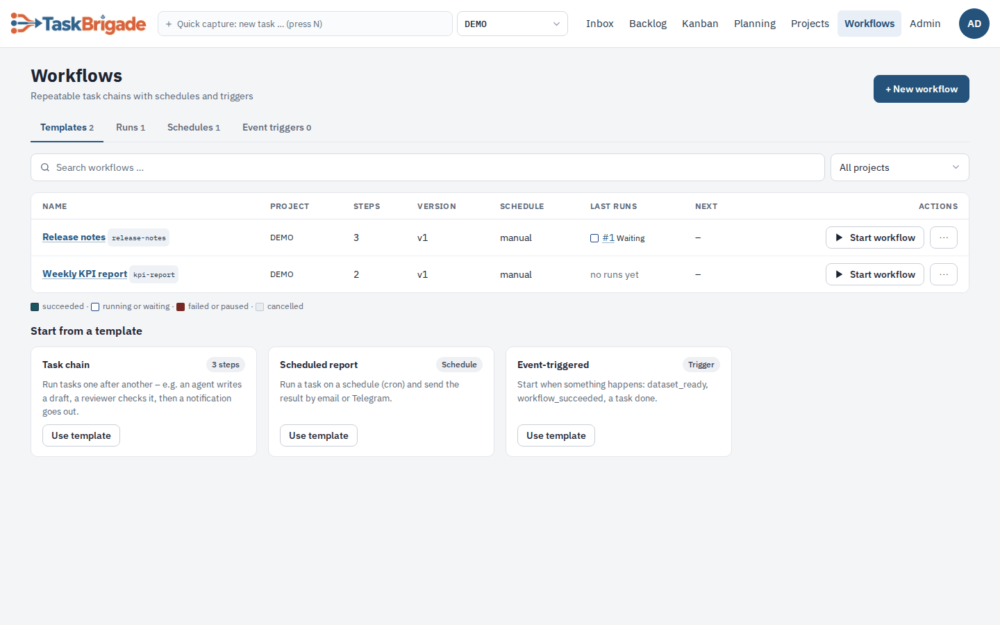
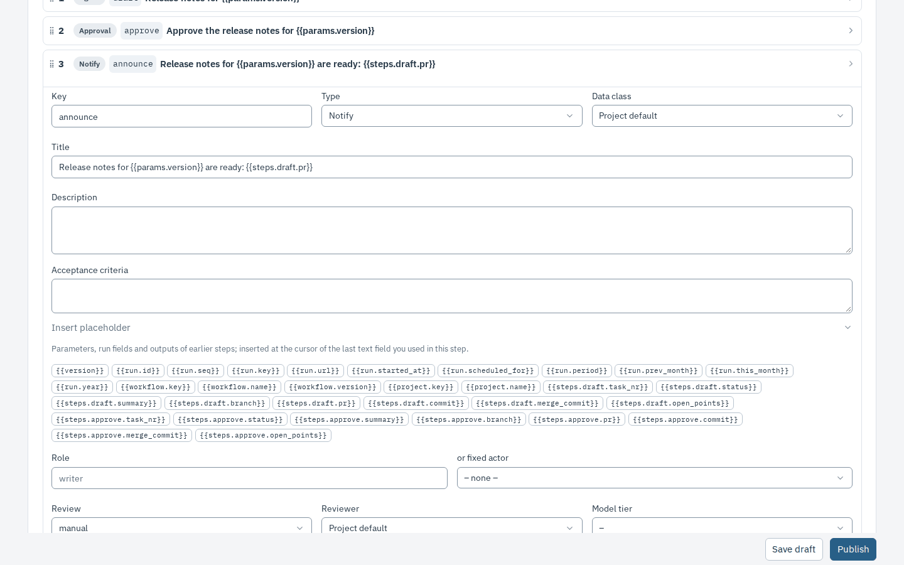
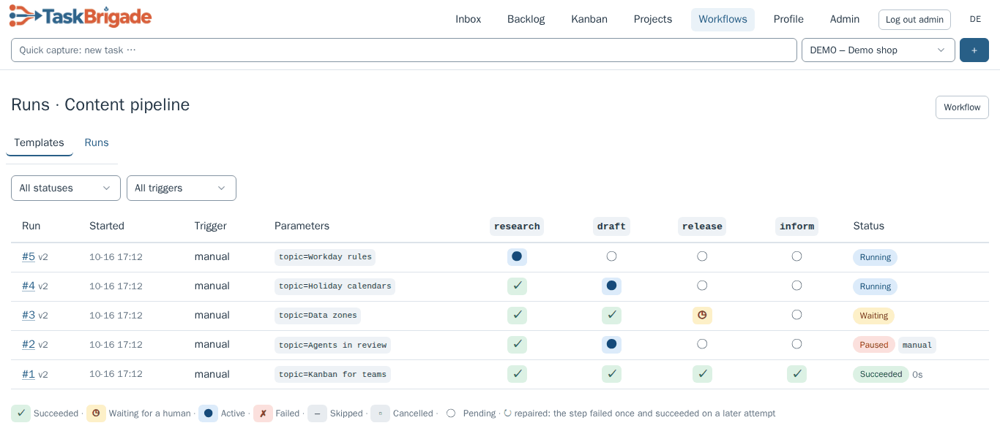
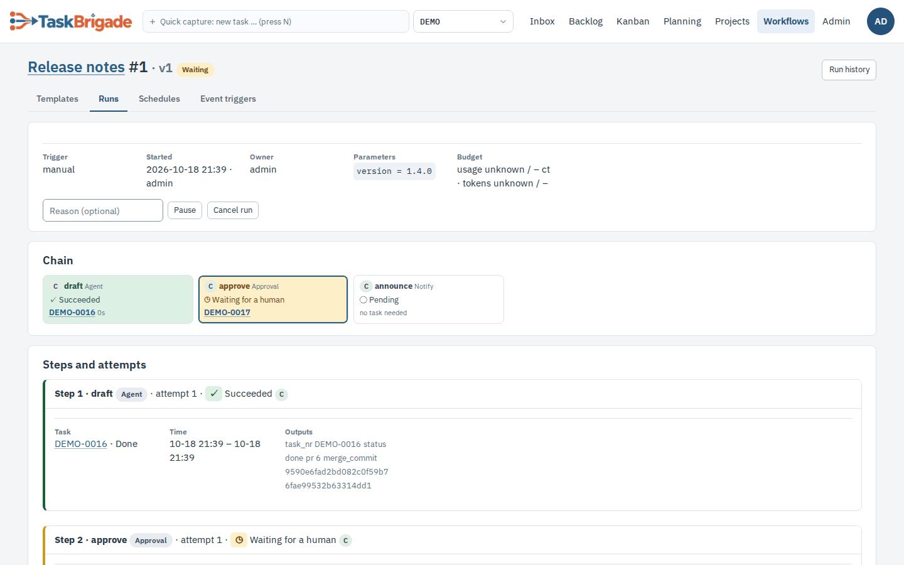
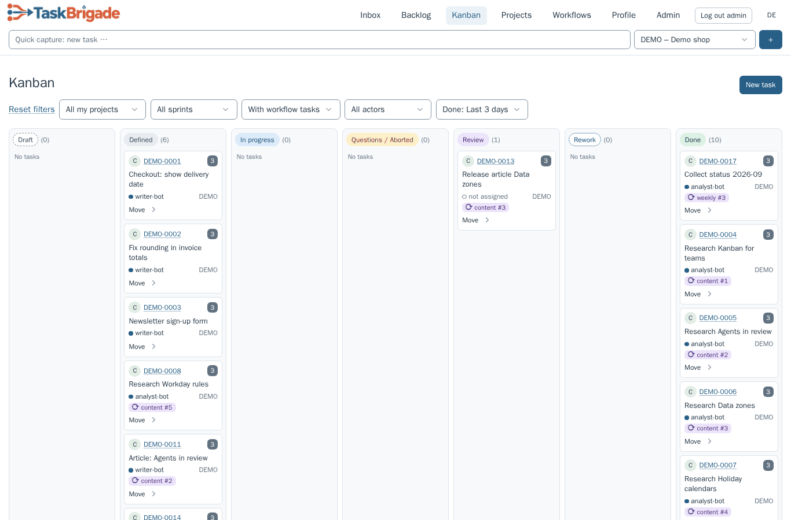
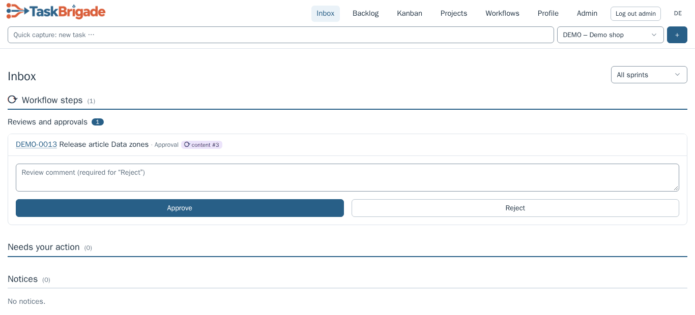
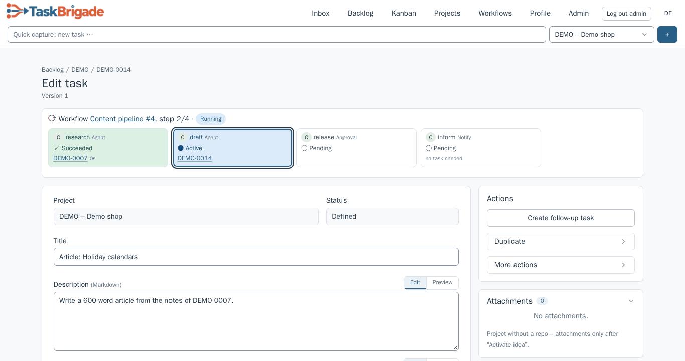

# Workflows in the web UI

The menu **Workflows** shows workflow templates and their runs. It sits between *Projects* and *Data* and is
visible to every signed-in actor; the lists only contain projects you may read (admins, the human project owner
and project members). Labels below are the English ones; with `UI_LANGUAGE=de` the menu is also called
*Workflows* and the sub-pages *Vorlagen* and *Läufe*. Background: [run engine](workflow-engine.md),
[output contracts](workflow-outputs.md), [API, CLI and MCP](workflows-api.md), [overview](workflows.md).

## Templates

*Workflows → Templates* lists one row per template: name and key, project, number of steps, current version
(“(draft)” while an unpublished draft exists), schedule, the last five runs as coloured squares and the newest run
with its status. The columns *Schedule* and *Next* of this list still say “manual” and stay empty; schedules are
managed and listed under **Workflows → Schedules** and *Manage schedules* on the template
([workflow-schedules.md](workflow-schedules.md)). The tabs *Templates | Runs | Schedules | Event triggers* show the number of entries you may read. Search by name or key
and filter by project at the top; without any workflow the page shows an empty state. Below the list, **Start from a
template** offers three start templates (*Task chain*, *Scheduled report*, *Event-triggered*, shown to everyone who may
create workflows): **Use template** opens the new-workflow form prefilled with a key and name, and creating it stores
a draft with example steps (agent, approval and notify steps with role-based assignment, so they publish without
data zones). A schedule or event trigger is not created automatically; the form and the editor banner say where to add
it after the first publication. **+ New workflow** (admins,
orchestrators, project owners) asks for project, key and name and opens the editor; the key becomes the `PROJECT/key` used by `tbr workflow` and cannot be
changed later.

The **Actions** column offers **Start workflow** and **More actions**; on phones these sit in each card's footer
and the menu opens as a bottom sheet. Starting uses the published version only. Unpublished drafts show a disabled
button with an explanation. Parameters without defaults or an existing default budget open a dialog with optional
token/cost budgets; otherwise the run starts immediately with its defaults. A success notice links to the run and
refreshes the recent runs and tab counts.

**Rename** changes only the display name (required, at most 120 characters), preserving the key and references.
**Duplicate** opens a new draft in the same project, copied from the latest draft or published version, with a
**Copy of …** name and a unique `Copy`/`Copy2` key suffix. Steps, parameters and default budgets are copied;
schedules, event triggers and reviewed script pins are not. **Delete** confirms the name, key, run count and active
schedule/trigger counts. Active runs (including queued, waiting and paused runs) must be cancelled first. Deletion
archives the workflow, disables schedules/triggers and hides it from Templates; existing runs, tasks and history
remain accessible under Runs. These actions enforce the same edit/start permissions as the editor and run engine.

The template page shows the selected version (default: the current one) with its parameters and steps. Step texts
of a data class you may not read are hidden. On the right: **Versions** with publication time, publisher, change
note, run count and a **Diff** link to the previous version, and the last runs. **Start a run** (admins,
orchestrators, template and project owners) lists the parameters of the current version; empty fields use the
default. The run page opens after the start.

## Editor

**Edit** (or **Edit draft**) opens the draft – or, without a draft, a copy of the current version. The editor is a
linear list, not a graph:

- **Parameters**: name, type, required/optional, default (literal or run field such as `{{run.prev_month}}`),
  enum values (comma-separated), label and help text. **+ Parameter** adds a row, **×** removes it.
- **Steps**: each row folds open. Drag the handle **⠿** or use **Move up** / **Move down** to reorder; **Remove
  step** deletes it, **+ Step** with a type adds one at the end. Fields: key, type, data class (empty = project
  default), title, description, acceptance criteria, role *or* fixed actor, review mode, reviewer, model tier,
  timeout (minutes), retries, optional, **Parallel group** and **When**. **When** skips the step when its value is
  empty or false (see [workflow-engine.md](workflow-engine.md) for the falsy literals); steps sharing a **Parallel
  group** start together and finish the group when all are done. **Outputs, inputs and settings (JSON)** holds the
  output contract, input bindings and step settings such as `{"to": ["owner"]}` for notify or
  `{"on_reject": "rework:write"}` for approvals, in the formats of [workflow-outputs.md](workflow-outputs.md) and
  [workflow-engine.md](workflow-engine.md).
- **Insert placeholder** lists what a step may use: parameters, run/workflow/project fields and the built-in and
  declared outputs of *earlier* steps. A click inserts the placeholder at the cursor of the last text field used in
  that step. The list follows the current order.
- **Checks** re-runs the publish checks after every change, on the unsaved form: unknown placeholders, wrong
  filters, undeclared outputs, assignment rules, roles without a candidate (warning), auto review that is not
  allowed, zone boundaries without a gate, invalid JSON or input. Errors block publishing; warnings do not.

**Save draft** stores the draft (one draft per template; saving again replaces it). **Publish** saves and then
publishes it as the new current version; if a check fails, the draft stays saved and the error is shown. Running
runs keep the version they started with. **Discard draft** deletes the draft; published versions are untouched.
**Diff vs v*N*** compares the draft with the current version; *From*/*To* on the diff page compare any two versions.

**Export YAML** downloads the shown version (or the draft, *Export draft YAML*) as the canonical YAML document of
[workflows-api.md](workflows-api.md). **Import YAML** uploads such a document: it becomes the **unpublished** draft
(*Import as draft*) or is published right away (*Import and publish*). The document runs through the same checks as
the editor; a blocking problem is refused and nothing is stored. Importing never auto-publishes behind your back –
without *Import and publish* you review the draft in the editor first.

## Event triggers

**Workflows → Event triggers** lists triggers you may read. On a template, **Event triggers** opens
`/workflows/PROJ/key/triggers`. Human admins, the project owner and the template owner can save a trigger:
kind (`dataset_ready`, `workflow_succeeded`, `workflow_failed`), enabled, a JSON filter and JSON parameters.
Agents cannot. The page also lists recent deliveries (started, skipped because another run is active, or failed).
See [Event triggers](workflow-events.md).

## Runs

**Run history** on the template page is a pipeline: one row per run (newest first) with start time, trigger and
parameters, one column per step and the run status with its duration. Filter by *Status* and *Trigger*. Cells
carry symbol *and* colour:

| Cell | Meaning |
|---|---|
| ✓ green | succeeded |
| ● blue | active (task open) |
| ◷ amber | waiting for a human (question) |
| ✗ red | failed |
| – / ▫ grey | skipped / cancelled |
| ○ dashed | pending |
| ↻ | repaired: failed once, succeeded on a later attempt |

A cell links to the step's task, the run number to the run page. *Workflows → Runs* lists runs of all readable
templates with progress (“2 of 3 steps”).

The run page shows trigger, start, starter, owner, parameters and budget, then the **Chain**: one box per step with
data class, status, task and duration; the current step is framed. **Steps and attempts** lists every attempt with
task, time, outputs and error code. Values of a data class you may not read show as `***`. Admins, the template
and project owner and the starter see **Pause** (with an optional reason), **Resume** (from the current or an
earlier step; *skip* only for optional steps) and **Cancel run**, which also cancels the run's open tasks.

## Run tasks on Kanban, Backlog, Inbox and the task page

- **Kanban and Backlog** hide workflow tasks by default. The filter *Hide workflow tasks* / *With workflow tasks* /
  *Only workflow tasks* / one template is remembered per browser (cookie `tm_workflow`), counts as an active
  filter, and **Reset filters** sets it back to *hide*. While tasks are hidden, a line under the board or table says
  “3 workflow tasks hidden – show”.
- Cards and backlog rows of workflow tasks carry the badge **⟳ key #run**, linking to the run.
- **Inbox**: workflow tasks are never hidden. Questions, reviews, approvals and aborted tasks of runs are grouped
  under **Workflow steps** above *Needs your action*. Approval steps show **Approve** instead of *Approve & merge*
  – they have no pull request.
- The **task page** of a workflow task names the workflow, run and step (“step 2/3”) and shows the run's chain with
  the task highlighted.

Workflow tasks never belong to a sprint, so sprint pages do not show them. Agents see no difference: `tbr run`,
`list_tasks` and claim treat workflow tasks like other tasks.
