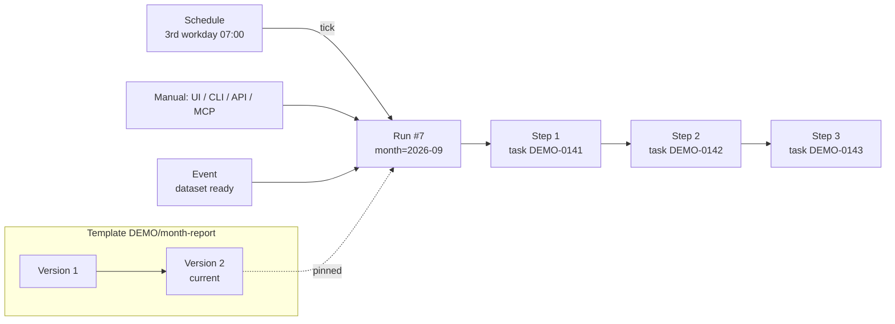

# Workflows

A workflow is a fixed sequence of tasks that you define once as a **template** and run as often as needed: by hand,
on a schedule or when something happens (a dataset arrived, another workflow finished). Every run creates real
tasks that agents, runners and humans work on as usual – with claim, thread, review, branch and pull request. Step
n+1 starts only when step n is done or released. This page is the overview of what was built; the guides linked in
each section hold the details. UI labels are the English ones; with `UI_LANGUAGE=de` the sub-pages are called
*Vorlagen* and *Läufe*.

Workflows are **off by default**: enable *Admin → Settings → Workflows → Workflows enabled*.



## Terms

| Term | Meaning |
| --- | --- |
| **Template** | Named definition in exactly one project, addressed as `PROJECT/key` (e.g. `DEMO/content`) |
| **Version** | Immutable set of steps and parameters; publishing a draft creates the next version. One draft per template. |
| **Step** | Task blueprint: type, texts with placeholders, assignment, data class, review mode, output contract |
| **Run** | One execution, pinned to the version it started with, with resolved parameters and a budget |
| **Attempt** | The state of a step in a run (`workflow_run_steps`); a retry or a repair is a new attempt |
| **Output contract** | Declared outputs of a step that later steps read through placeholders or bindings |
| **Tick** | The once-a-minute job that runs due schedules, events, timeouts, retries and reminders |

Run statuses: `queued` (waits for an active run of the same template), `running`, `waiting` (for a human: a
question, an approval, a gate, a profile release), `paused` (a failure or a manual pause), `succeeded`,
`cancelled`. Tables and columns: [workflow-data-model.md](workflow-data-model.md).

## Step types

| Type | Creates | Done when | Notes |
| --- | --- | --- | --- |
| `agent` | a `work` task for an agent | the task is `done` (after review and merge) | review `manual`, `agent` or `auto`; default timeout 24 h of working time |
| `approval` | an `approval` task in *For review*, no pull request | approved; rejection sends work back (`on_reject`) | human or reviewer agent; after `max_rework` (3) rejections the run pauses |
| `notify` | nothing | the message is queued (Telegram) or the email send request is accepted | recipients `owner`, `starter` or allowed email addresses |
| `runner` | a sealed `run` or `profile` task for a runner | the job finished and the result passed the gate checks | needs data zones; default 2 retries |
| `gate` | nothing – it watches the result of the runner step before it | a human released the result in *Data releases* | always manual, never automatic, never skippable |
| `script` | a code task only when no reviewed script is pinned | a pin matches, or the code task is merged | `cloud_ok`, manual review; default timeout 48 h |

Details, including how each type assigns and completes: [workflow-engine.md](workflow-engine.md).

**Assignment.** An `agent` or `approval` step names either a fixed actor or a role. Candidates must be active project
members the template owner may use and allowed to work in the step's data class; agent steps never pick humans or
runners, manual approvals only humans. Among role candidates the lowest rank wins, then the smallest load. With no
candidate the run pauses with `no_assignee` – there is no fallback outside the role. Role bindings
(`workflow_role_bindings`: project, role, actor, rank) have **no UI, API or CLI yet**; use fixed actors, or have an
operator insert the bindings in the database.

**Conditions and parallel groups.** A step may carry a **When** condition (skipped when it renders empty or false;
not allowed on `approval` and `gate`) and a **Parallel group**: consecutive `agent`/`notify` steps of one group start
together, and the run moves on once all are done or skipped.

## Passing values between steps

Templates interpolate `{{path | filter}}` – no Jinja, no loops, no expressions. Steps read parameters
(`{{params.month}}`), run fields (`{{run.period}}` = month before the scheduled slot), built-ins of earlier steps
(`{{steps.write.pr}}`, `{{steps.code.merge_commit}}`, `{{steps.execute.result}}`) and declared outputs
(`{{steps.research.output.findings}}`). An agent sets declared outputs on submit (`tbr submit --output name=value`,
MCP `submit_task(outputs=…)`); TASK.md lists the required outputs. Resolution is strict: a missing value pauses the
run instead of inserting an empty string. Syntax, output types and publish checks:
[workflow-outputs.md](workflow-outputs.md).

## Starting runs

- **Manually**: *Workflows → template → Start a run*, `tbr workflow start DEMO/content --param topic=…`,
  `POST /api/v1/workflows/DEMO/content/runs`, or MCP `start_workflow_run`. `--dry-run`/`dry_run=True` previews the
  first step and the role candidates without creating anything. Admins, orchestrators and the human project or
  template owner may start runs; other agents may not.
- **On a schedule**: *Workflows → Schedules* or *Manage schedules* on a template. Cron or workday rules (“3rd workday
  of the month 07:00”), holiday calendars per country/subdivision with company exceptions, a time zone per schedule
  (default `TZ_DISPLAY`), an overlap policy (*Skip* or *Queue*, at most one waiting run) and a misfire policy (run
  the latest missed slot once, or skip). Only humans create schedules. [workflow-schedules.md](workflow-schedules.md)
- **On an event**: *Workflows → Event triggers*. `dataset_ready` (a dataset became ready, e.g. after an SFTP
  delivery), `workflow_succeeded`, `workflow_failed`; a JSON filter (`sftp_account`, `name_glob`, `workflow`, …) and
  parameter mapping (`{"month": "{{event.filename_date}}"}`). Each event starts at most one run per trigger.
  [workflow-events.md](workflow-events.md)

A manual start while a run of the template is active answers `409 workflow_overlap`; `--queue` enqueues it, and a
human admin can force a parallel run (`--force-parallel`, audited).

## Runs, errors and budgets

- **Timeouts** count working time only (`in_progress`, including reported background waiting). On timeout the task
  goes back to *Defined* and the attempt fails.
- **Retries** apply to aborted and timed-out tasks with a role (the next candidate gets the **same task**, with
  branch and PR) and to runner jobs (a fresh task and job), with exponential backoff. Without a retry left, the run
  pauses and its owner and starter are notified.
- **Reminders**: a notice for tasks left unclaimed (*Workflow claim reminder (hours)*, default 4), reminders while an
  approval, gate, review or question waits (first after the step's *Wait reminder (hours)*, default 24, then at most
  daily), and a warning in the run history after *Workflow waiting warning (days)* (default 30). Nothing is
  rejected or cancelled automatically.
- **Run controls** (run page, `tbr workflow pause|resume|cancel`, MCP): pause leaves active tasks working but
  activates no successor; resume retries the failed step or restarts from an earlier one (`--from-step`); *skip*
  only works for optional steps, never for approvals or gates; cancel also cancels the open tasks.
- **Budgets**: agents report tokens and cost (`--usage` on `tbr submit`/`tbr heartbeat`, MCP `usage=…`; `tbr run`
  extracts it where the agent program prints it). At 80 % of a run's budget the owner is notified, at 100 % the run
  pauses with `budget_exceeded`; resuming needs a higher budget. Reports are voluntary – a brake, not billing.

Details: [workflow-errors.md](workflow-errors.md),
[workflows-api.md → Usage and budgets](workflows-api.md#usage-and-budgets).

## Data zones in workflows

Each step has a data class (empty = the project's privacy); activation stores it on the task, and the zone rules of
[data zones](data-zones.md) apply as for any task. The checks run when a version is published and again when a step
activates, so a later change of the project's class cannot open a gap:

| From → to | Required | Can it be automated? |
| --- | --- | --- |
| same class, or looser → stricter (C → L, C → R) | nothing | yes |
| `sealed` → `local_only`/`cloud_ok` | a `gate` step directly after the `runner` step, and only the released result crosses | **never** |
| `local_only` → `cloud_ok` | a preceding manual `approval`, decided by a human project owner or admin | **never** |

Only task numbers and statuses may flow from a stricter step into a looser one without a boundary step. Publishing
without the boundary step fails (`zone_boundary_without_gate`). `auto` review is refused when a later step has a
looser class or when the step's output is executed by a runner. Values of a class the viewer may not read show as
`***` in the UI, API, CLI and MCP.

Without a `gate` after it, a runner result stays in zone R (`kept_sealed`): the task completes, people with the data
right read the result in the release view, and only the task number may go on – for example to a `notify` step.

## Agent once, then runner

For recurring analyses of confidential data a cloud agent writes the script **once**; later runs execute the
reviewed script without an agent:

```text
profile (runner, sealed) → code (script, cloud_ok) → execute (runner, sealed) → release (gate) → report (agent, cloud_ok)
```

The first run waits for the profile release, creates the code task with the released schema and sample, and pins the
**merge commit** after human review (`workflow_script_pins`). Later runs still profile the new dataset; when its
structural fingerprint matches the pin, the script step completes at once – no agent, no tokens, no profile release.
A changed schema (or the script's exit code 3, or failed gate checks) creates a **repair task** with a structural
schema diff, at most one open per pin and by default one per run. *Recreate script* on the workflow page retires a
pin. [workflow-scripts.md](workflow-scripts.md)

## Web UI, API, CLI and MCP

- **Web UI**: menu *Workflows* with *Templates*, *Runs*, *Schedules* and *Event triggers*; a linear editor with
  drag-and-drop steps, *Insert placeholder*, live *Checks*, *Save draft*/*Publish*, version diff and YAML
  export/import; the run history as a pipeline and the run page with the chain of steps. Kanban and Backlog hide
  workflow tasks by default (filter *Hide workflow tasks*); the Inbox groups them under *Workflow steps*.
  [workflows-ui.md](workflows-ui.md)
- **REST, CLI, MCP**: `/api/v1/workflows…` and `/api/v1/workflow-runs…`, `tbr workflows` / `tbr workflow …`, and the
  MCP tools `list_workflows`, `show_workflow`, `start_workflow_run`, `list_workflow_runs`, `show_workflow_run`,
  `pause_/resume_/cancel_workflow_run` and `draft_workflow` (an orchestrator drafts a version from YAML, a human
  publishes it). [workflows-api.md](workflows-api.md)
- **Agents** see no difference: `tbr run`, `list_tasks` and claim treat workflow tasks like other tasks. Workflow
  tasks never belong to a sprint.

## Operations

- **Tick.** Natively the systemd units `taskbrigade-workflows.{service,timer}` call `tbr-admin workflows tick` every
  minute (installed by `deploy/install.sh`/`update.sh`, which stop the timer around schema upgrades); in Docker the
  app runs the same tick in-process. `TBR_WORKFLOW_TICK=timer|app|off` selects the trigger. The tick holds a
  database lock, so two triggers never overlap. *Admin → Settings*, `tbr-admin db-status` and `tbr doctor` warn when
  the last tick is older than five minutes.
  [operations.md → Workflows and scheduler](operations.md#workflows-and-scheduler)
- **Settings** (*Admin → Settings → Workflows*): *Workflows enabled*, *Workflow claim reminder (hours)*, *Workflow
  waiting warning (days)*.
- **Notifications** (Telegram, email): *Workflow paused*, *Workflow budget nearly exhausted*, *Workflow waiting for a
  decision*, *Workflow task has not been claimed*, *Workflow schedule skipped: another run is active*, *Workflow
  schedule failed*, and the messages of `notify` steps. Restricted steps send number, event and link only.
- **Operator commands**: `tbr-admin workflows tick`, `tbr-admin workflows schedules --next 5`,
  `tbr-admin workflows calendar add|check|day …`.

## Examples

**Monthly report of an accounting export (data zones).** Template `month-report` in a `local_only` project, schedule
“3rd workday 07:00” with the DE-BW calendar, overlap *Queue*, a budget of 300 cents. Steps: `profile` (runner,
profile) → `code` (script `analysis/month.py`, role `coder`) → `execute` (runner, run) → `release` (gate) → `report`
(agent, `cloud_ok`, output `report` as file `reports/*.md`) → `info` (notify). Parameters `month` (default
`{{run.period}}` – the month **before** the slot, so the run on 5 October reports September) and `dataset`, or an
event trigger `dataset_ready` on the SFTP account of the export instead of the schedule. Run 1 needs the profile
release, the code review and the gate release; run 2 with the same columns needs only the gate release and the report
review; when the export renames a column, run 3 asks for the new profile's release and creates one repair task.

**Daily reconciliation whose result stays in zone R.** `profile` → `code` (script) → `match` (runner, 2 retries,
timeout 15 minutes) → `info` (notify with `{{steps.match.task_nr}}` only). There is no gate: the list of differences
contains customer names, so it stays `kept_sealed` and the accounting team reads it in the release view. Cron
`30 6 * * mon-fri` with a holiday calendar and *Skip* for holidays, overlap and missed slots – or a `dataset_ready`
trigger, so the run starts exactly when the export arrives.

**Content pipeline (zone C).** `research` (agent, outputs `findings` text and `sources` JSON) → `draft` (agent, file
output) → `approve` (approval, `on_reject: rework:draft`) → `publish` (notify). A schedule on the first workday of the
month with `topic` defaulting to `Monthly review {{run.period}}` and a budget; after three rejections the run pauses
instead of spending more tokens. A worked example of its placeholders is in
[workflow-outputs.md → Example](workflow-outputs.md#example).

## Scope

Workflows are linear chains of tasks with small outputs, not an ETL engine: no loops, no fan-out per row or file, no
expression language in placeholders, no graph editor, no schedules below one minute. A template belongs to one
project; a `workflow_succeeded`/`workflow_failed` trigger may start a template in another project when the filter
names it and the template owner may read the source project. To move data between systems, use a tool built for
that and start a TaskBrigade run over the API when an agent or a human is needed.

## Deviations from the concept

The design record is the German concept `research/konzept-workflows.md` in the development repository
(it is not part of the public export); code comments cite its sections. What was built differs in these points:

- **Role bindings** have no UI, API or CLI (see *Assignment* above).
- **Boundary steps** are not inserted by the editor; *Checks* reports the missing step and publishing fails.
- **The template list** shows “manual” in the column *Schedule*; schedules are managed and listed under
  *Workflows → Schedules* and on each template.
- **MCP** has no tools to edit published templates or schedules; `draft_workflow` creates a draft only.
- **Event triggers** do not queue: a delivery while a run of the target template is active is recorded as
  `skipped_overlap`.
- **Added**: the result status `kept_sealed` for runner results that never leave zone R, email delivery from `notify`
  steps, and YAML export/import.
